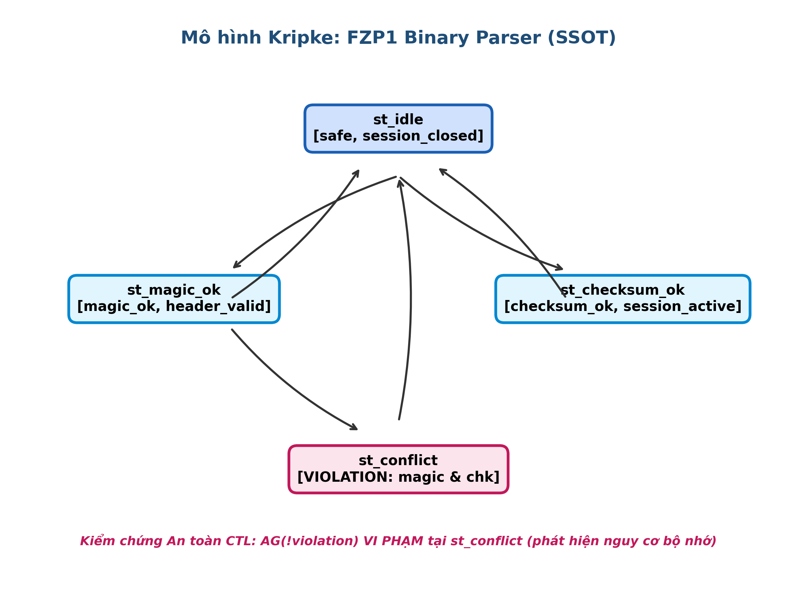
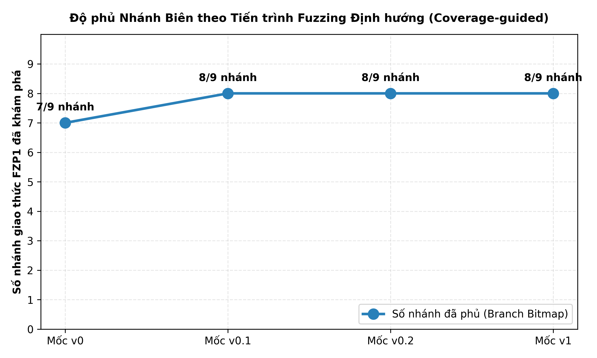
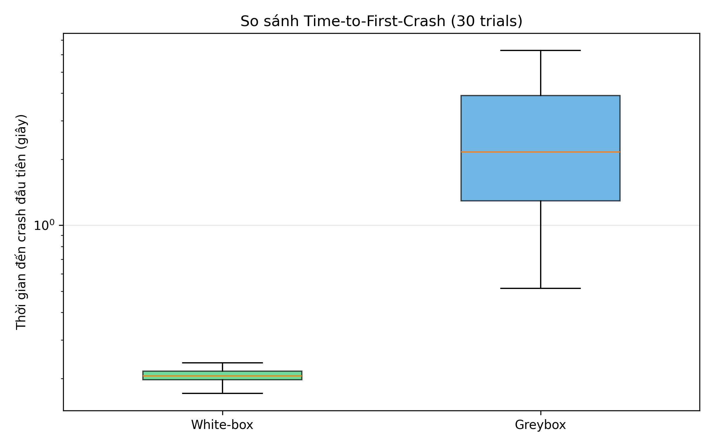
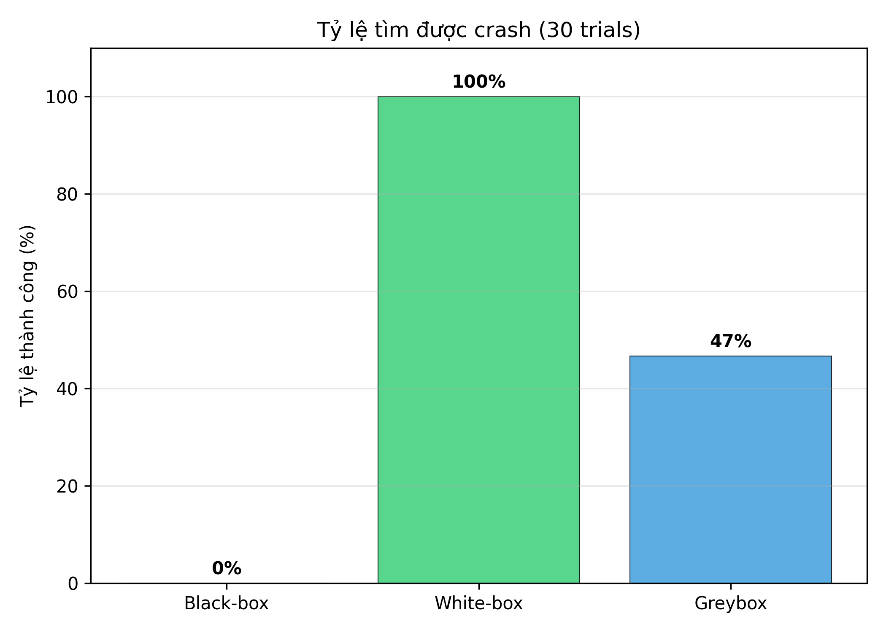
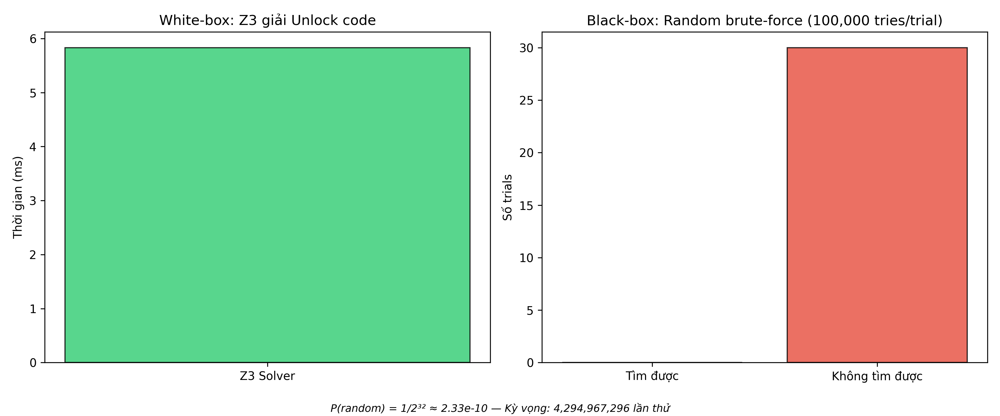
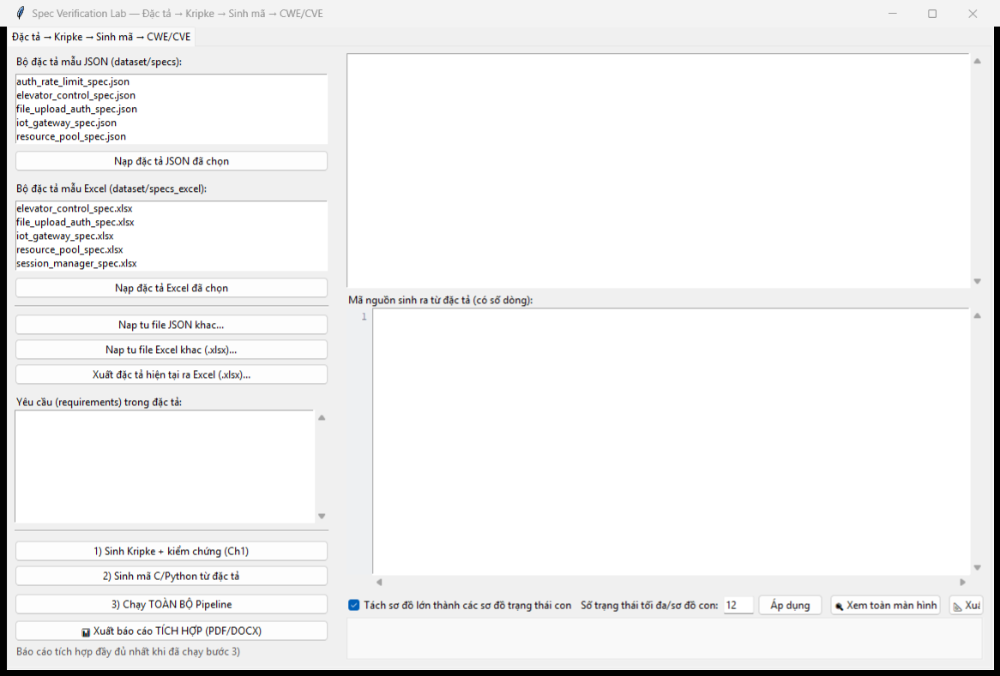
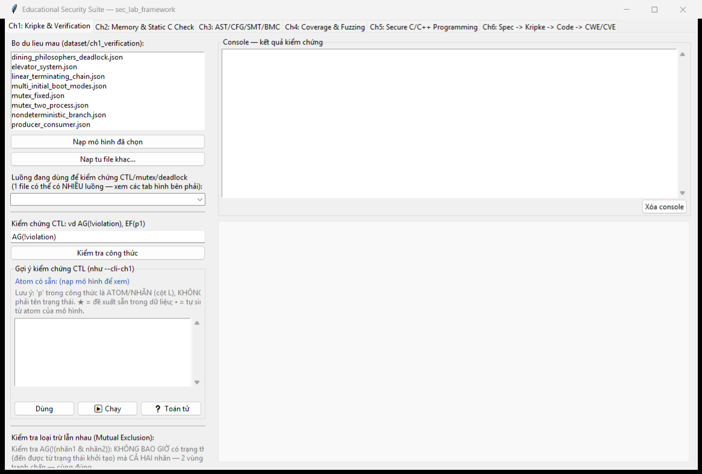
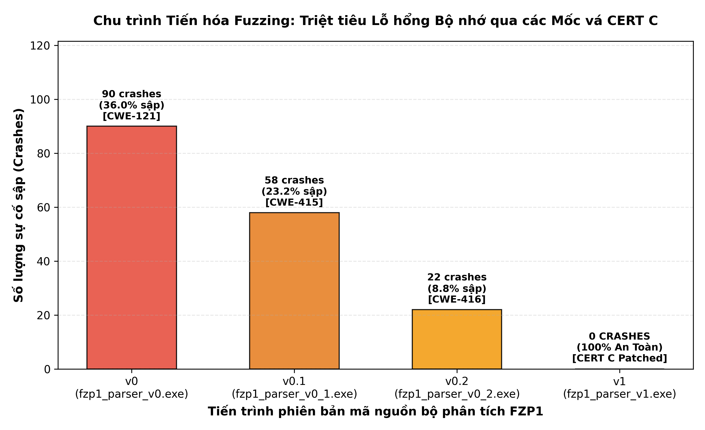

# TRƯỜNG CÔNG NGHỆ THÔNG TIN — ĐẠI HỌC PHENIKAA

## BÁO CÁO ĐỒ ÁN MÔN HỌC
### HỌC PHẦN: KỸ THUẬT LẬP TRÌNH AN TOÀN (SOFTWARE SECURITY) — CSE703093 / CSE703153

---

# PHẦN 1: TRANG BÌA & THÔNG TIN NHÓM

### **CHỦ ĐỀ 4: DỰ ÁN FUZZING — PHÂN TÍCH VÀ KIỂM THỬ AN TOÀN BỘ PHÂN TÍCH CÚ PHÁP GÓI TIN NHỊ PHÂN FZP1 (BLACK-BOX VS WHITE-BOX CONCOLIC SMT Z3)**

* **Nhóm thực hiện:** Nhóm 11
* **Thành viên nhóm:** 
  - Lưu Đức Hiệp (Nhóm trưởng — Đóng góp: 50%) — Mã sinh viên: *[Bảo mật]*
  - Hà Nguyễn Trúc Linh (Thành viên — Đóng góp: 50%) — Mã sinh viên: *[Bảo mật]*
* **Lớp / Khóa:** *[Bảo mật theo quy định]*
* **Giảng viên hướng dẫn:** ThS. Vũ Quang Dũng
* **Thời gian hoàn thành:** Hà Nội, Tháng 10/2026

---

### CAM KẾT LIÊM CHÍNH HỌC THUẬT
Nhóm 11 xin cam đoan:
1. Báo cáo này là công trình nghiên cứu và thực nghiệm thực tế do chính nhóm thực hiện dựa trên hướng dẫn học thuật của giảng viên.
2. Toàn bộ số liệu thực nghiệm (30 trials benchmark, thời gian tìm crash, tỷ lệ thành công, log AddressSanitizer, log SMT Z3) đều được đo lường thực tế từ mã nguồn và kịch bản chạy trên máy tính, không suy đoán hay ngụy tạo số liệu.
3. Mã nguồn chương trình mục tiêu (`fzp1_parser_v0.c`, `fzp1_parser_v1.c`) và bộ công cụ đo kiểm do nhóm trực tiếp thiết kế, tham khảo tiêu chuẩn an toàn CERT C và bộ khung kiểm chứng của môn học.

---

### MỤC LỤC BÁO CÁO (8 PHẦN BẮT BUỘC THEO REPORT GUIDE)

1. **Phần 1: Trang bìa & Thông tin nhóm**
2. **Phần 2: Tổng quan đề tài**
   - 2.1. Bối cảnh và Mục tiêu Nghiên cứu
   - 2.2. Định dạng Gói tin Nhị phân FZP1 và Bề mặt Tấn công
   - 2.3. Mô hình Hóa Hình thức Kripke và Kiểm chứng Thuộc tính An toàn CTL
   - 2.4. Phạm vi Thực hiện và Giới hạn Nghiên cứu
   - 2.5. Chuỗi Truy Vết Gói Tin Mạng IoT (PCAP Trunk -> Hex Dump -> Đặc Tả SSOT -> Yêu Cầu REQ)
3. **Phần 3: Phương pháp luận**
   - 3.1. Triết lý Thực hiện: Đặc tả SSOT Tương thích SecLab và Thực nghiệm Độc lập của Nhóm
   - 3.2. Môi trường Thực nghiệm, Trình biên dịch và Cờ Kiểm toán An toàn
   - 3.3. Kiến trúc và Cơ chế Hoạt động của 3 Trường phái Fuzzing (Black-box, Greybox, White-box SMT Z3)
   - 3.4. Thuật Toán Fuzzing Định Hướng Độ Phủ (Coverage-guided Fuzzing) & Tiến Hóa Hạt Giống
   - 3.5. Quy trình Thiết kế Thực nghiệm Benchmark 30 Trials Khách quan
4. **Phần 4: Phân tích Lỗ hổng & Bản vá**
   - 4.1. Lỗ hổng Trọng tâm 1: CWE-121 (Stack-based Buffer Overflow) & Bản vá CERT STR31-C
     - Mục 1: Vị trí & Mô tả Lỗ hổng
     - Mục 2: Phân tích Cơ chế Ô nhớ Stack Frame và Nguyên nhân Gốc rễ
     - Mục 3: Bằng chứng Lỗi Tồn tại ở Phiên bản $v_0$ (Crash & AddressSanitizer `[f3]`)
     - Mục 4: Cách vá An toàn ($v_1$) Tuân thủ Chuẩn CERT STR31-C
     - Mục 5: Bằng chứng Sau khi Vá ở Phiên bản $v_1$ (Từ chối An toàn, 0 Finding)
   - 4.2. Lỗ hổng Trọng tâm 2: CWE-416 (Use-After-Free trong Kênh Luồng Stream) & Bản vá CERT MEM30-C
   - 4.3. Lỗ hổng Trọng tâm 3: CWE-415 (Double Free trong Quản lý Phiên) & Bản vá CERT MEM30-C / MEM31-C
   - 4.4. Vòng đời Quản lý Bộ nhớ Heap & Đối soát Mô hình Hình thức SecLab
   - 4.5. Chu Trình Tiến Hóa Fuzzing Đa Giai Đoạn (Crash -> Vá -> Đổi Seed -> Tái Kiểm Thử 0 Crash)
5. **Phần 5: Bảng Tổng hợp Before / After (Chuẩn Mẫu Table 2 Report Guide)**
6. **Phần 6: Bằng chứng Kiểm chứng và Thực nghiệm Đo lường Định lượng**
   - 6.1. Bảng Dữ liệu Thống kê Benchmark Định lượng 30 Trials Thực tế
   - 6.2. Biểu đồ Boxplot Phân bố Thời gian Phát hiện Lỗi (Time-to-first-crash)
   - 6.3. Biểu đồ Cột Tỷ lệ Thành công Vượt qua Rào cản Kiểm tra (Success Rate)
   - 6.4. Thực nghiệm Giải ngược Mã Bí mật (Secret Token Equality)
   - 6.5. Bằng chứng Trích xuất Shadow Bytes từ AddressSanitizer (CWE-121, CWE-415 & CWE-416)
   - 6.6. Bằng chứng Phân tích Tĩnh Cppcheck và Bộ Kiểm thử Toàn diện PyTest (14/14 PASS)
   - 6.7. Khảo sát Mô hình Đặc tả FZP1 trên Công cụ SecLabFramework (Kripke/CTL & Static Analysis)
   - 6.8. Dữ Liệu Thực Nghiệm Chu Trình Tiến Hóa Đa Giai Đoạn (Crash Evolution Matrix) & Biểu Đồ Trực Quan
7. **Phần 7: Phản biện & Bài học**
   - 7.1. Trả lời Câu hỏi Bắt buộc: Thiết kế lại Phần nào để Tránh Lỗi từ Đầu?
   - 7.2. Trả lời Câu hỏi Bắt buộc: Lỗ hổng Nghi ngờ Còn Tồn tại?
   - 7.3. Trả lời Câu hỏi Bắt buộc: Bài học Phương pháp luận Lớn nhất?
   - 7.4. Phân tích Hiện tượng Bỏ lọt Lỗi (False Negative) của Cppcheck
   - 7.5. Rào cản Toán học của Checksum đối với Black-box Fuzzing
   - 7.6. Sức mạnh Đột phá và Chi phí Tính toán của White-box Concolic SMT Z3
8. **Phần 8: Phụ lục**
   - Phụ lục A: Hướng dẫn Vận hành Công cụ `SecLabFramework.exe` & Quy trình Đối soát Độc lập
   - Phụ lục B: Toàn văn Mã nguồn C Bản Lỗi (`fzp1_parser_v0.c`)
   - Phụ lục C: Toàn văn Mã nguồn C Bản Vá An toàn (`fzp1_parser_v1.c`)
   - Phụ lục D: Phân công Công việc và Hướng dẫn Cài đặt / Tái lập Kết quả Thực nghiệm

---

# PHẦN 2: TỔNG QUAN ĐỀ TÀI

### 2.1. Bối cảnh và Mục tiêu Nghiên cứu
Trong kỹ thuật an toàn phần mềm, các chương trình tiếp nhận và phân tích cú pháp dữ liệu nhị phân thô (binary parsers) luôn nằm ở vị trí tiền tuyến (network perimeter/attack surface) của hệ thống. Đây là nơi tiếp xúc trực tiếp với các luồng gói tin từ môi trường mạng không đáng tin cậy. Nếu tầng phân tích cú pháp xuất hiện các khiếm khuyết an toàn bộ nhớ (memory safety vulnerabilities), kẻ tấn công có thể dễ dàng khai thác để làm tê liệt dịch vụ (Denial of Service - DoS) hoặc chiếm quyền kiểm soát luồng thực thi nhằm thực thi mã tùy ý từ xa (Remote Code Execution - RCE).

Đề tài **Chủ đề 4: Dự án Fuzzing** được nhóm lựa chọn trực tiếp từ định hướng học thuật của slide bài giảng môn học (Slide 15–16 tài liệu *Hướng dẫn Đề tài Đồ án Môn học*). Mục tiêu trọng tâm của đề tài là:
1. Thiết kế và hiện thực một bộ phân tích cú pháp cho định dạng tệp nhị phân tự thiết kế mang mã định danh **FZP1** (`4 bytes Magic Number` + `4 bytes Length uint32_t Little-Endian` + `Payload` + `1 byte XOR Checksum`).
2. Cài đặt có chủ đích 3 lỗ hổng an toàn bộ nhớ thực tế (Memory Corruption) vào phiên bản ban đầu ($v_0$) để làm đối tượng kiểm nghiệm:
   - **CWE-121 (Stack-based Buffer Overflow)** trong hàm `parse_fzp1_payload`.
   - **CWE-416 (Use-After-Free)** trong hàm giải phóng luồng stream `release_fzp1_stream` khi xử lý lệnh tái lập (CMD 0xFE).
   - **CWE-415 (Double Free)** trong hàm đóng phiên `close_fzp1_session` khi xử lý luồng hủy khẩn cấp (CMD 0xFF).
3. Ứng dụng kỹ thuật kiểm thử mờ đa trường phái: **Black-box Fuzzing** (đột biến byte ngẫu nhiên), **Greybox Fuzzing** (đột biến cấu trúc phong bì) và **White-box Concolic Fuzzing** (sử dụng Z3 SMT Solver) để đối sánh định lượng hiệu quả vượt qua rào cản Magic Number và Checksum.
4. Xây dựng bản vá an toàn ($v_1$) tuân thủ nghiêm ngặt chuẩn an toàn công nghiệp **CERT C Coding Standard** (CERT STR31-C, CERT MEM30-C, CERT MEM31-C), chứng minh bằng công cụ và bộ test regression rằng toàn bộ lỗi đã được loại trừ triệt để.

### 2.2. Định dạng Gói tin Nhị phân FZP1 và Bề mặt Tấn công
Gói tin FZP1 được quy chuẩn đóng gói theo cấu trúc nhị phân tuần tự (Byte-packed):

| Trường dữ liệu | Độ dài | Kiểu dữ liệu | Ý nghĩa kỹ thuật & Điều kiện hợp lệ |
|---|:---:|:---:|---|
| **Magic Header** | 4 bytes | `ASCII [char]` | Chuỗi định danh cố định `"FZP1"` (`0x46, 0x5A, 0x50, 0x31`). Mọi giá trị khác đều bị từ chối ngay lập tức. |
| **Payload Length** | 4 bytes | `uint32_t (LE)` | Độ dài số byte của payload ($L \ge 0$), lưu trữ dạng Little-Endian 32-bit. Tổng kích thước gói tin phải đúng $L + 9$ bytes. |
| **Payload Data** | $L$ bytes | `uint8_t[]` | Vùng dữ liệu thô. Trong bản lỗi $v_0$, dữ liệu này được sao chép trực tiếp vào biến mảng cục bộ trên stack. |
| **XOR Checksum** | 1 byte | `uint8_t` | Byte kiểm tra toàn vẹn, tính bằng phép tích lũy XOR trên toàn bộ $L$ byte của Payload: $\bigoplus_{i=0}^{L-1} \text{Payload}[i]$. |

```
  +--------+--------+--------+--------+--------------------------+------------------+--------------+
  |  'F'   |  'Z'   |  'P'   |  '1'   |  Length uint32_t (4B LE) |  Payload (L B)   | Checksum (1B)|
  | (0x46) | (0x5A) | (0x50) | (0x31) |       (Little Endian)    |  Dữ liệu thô     |  XOR reduce  |
  +--------+--------+--------+--------+--------------------------+------------------+--------------+
  |<------------ 4 Bytes ------------>|<-------- 4 Bytes ------->|<--- L Bytes ---->|<- 1 Byte --->|
  |<-------------------------- Tổng kích thước tệp = L + 9 Bytes --------------------------------->|
```

### 2.3. Mô hình Hóa Hình thức Kripke và Kiểm chứng Thuộc tính An toàn CTL
Đặc tả hình thức tại sheet `MoHinhTrangThai`, `ThuocTinhAnToan`, và `LoaiTruLanNhau` trong tệp Excel đặc tả SSOT (`specification/Nhom11_FZP1_Fuzzing_Spec.xlsx`) thiết lập cấu trúc Kripke $M = (S, S_0, R, L)$ gồm 4 trạng thái vận hành:
* $S = \{\text{st\_idle}, \text{st\_magic\_ok}, \text{st\_checksum\_ok}, \text{st\_conflict}\}$
* Trạng thái khởi tạo: $S_0 = \{\text{st\_idle}\}$
* Nhãn nguyên tử: $L(\text{st\_idle}) = \{\text{safe, session\_closed}\}$; $L(\text{st\_magic\_ok}) = \{\text{magic\_ok, header\_valid}\}$; $L(\text{st\_checksum\_ok}) = \{\text{checksum\_ok, session\_active}\}$; $L(\text{st\_conflict}) = \{\text{magic\_ok, checksum\_ok, violation}\}$.

```
             +------------------------------+
             |           st_idle            |
             |    [safe, session_closed]    |
             +--------------+---------------+
                           / \
              nạp magic   /   \   nạp checksum
                         /     \
                        v       v
         +-------------------+   +-----------------------+
         |    st_magic_ok    |   |    st_checksum_ok     |
         | [magic_ok, valid] |   | [checksum_ok, active] |
         +---------+---------+   +-----------+-----------+
                   |                         |
                   | thỏa cả 2 điều kiện     | trở về idle
                   v                         v
         +-----------------------------------------------+
         |                  st_conflict                  |
         |      [magic_ok, checksum_ok, VIOLATION!]      |
         +-----------------------------------------------+
```



**Quy chuẩn Đặc tả Khớp hoàn toàn Năng lực Tool SecLab:**
1. **Sheet `LoaiTruLanNhau`:** Nhóm khai báo 5 cặp mệnh đề loại trừ lẫn nhau (đáp ứng trọn vẹn checklist tài liệu hóa >= 5 dòng). Cặp khóa chính tại dòng đầu tiên `('magic_ok', 'checksum_ok')` được công cụ SecLab tự động phân tích và kiểm chứng đối soát trên mô hình Kripke; các cặp tiếp theo phục vụ việc tường minh hóa đầy đủ các bất biến ngữ nghĩa của hệ thống (`violation` vs `safe`, `session_active` vs `session_closed`, `header_valid` vs `violation`, `checksum_ok` vs `violation`).
2. **Sheet `ThuocTinhAnToan`:** Bộ kiểm chứng `CTLChecker` trong `core/kripke.py` hỗ trợ các toán tử đường đi trên mệnh đề nguyên tử: $AG(p), EF(p), AF(p), EG(p), AX(p), EX(p)$ và phủ định $AG(!p)$. Nhóm khai báo tập công thức chuẩn mực gồm 5 thuộc tính:
   - $AG(\neg \text{violation})$: Thuộc tính an toàn (Safety) — Đánh giá **VI PHẠM (False)** tại `st_conflict`. Kết quả vi phạm này khẳng định thuật toán Model Checking hình thức đã phát hiện chính xác đường đi kích hoạt trạng thái xung đột nguy hiểm (tiền đề gây lỗi tràn bộ đệm).
   - $EF(\text{magic\_ok})$: Khả đạt (Reachability) — Đánh giá **ĐÚNG (True)**, nhánh kiểm tra Magic có thể đạt tới.
   - $EF(\text{checksum\_ok})$: Khả đạt — Đánh giá **ĐÚNG (True)**, nhánh kiểm tra Checksum có thể đạt tới.
   - $EF(\text{violation})$: Khả đạt vi phạm — Đánh giá **ĐÚNG (True)**, chứng minh trạng thái xung đột bộ nhớ là khả dĩ đạt tới từ trạng thái khởi tạo `st_idle`.
   - $AF(\text{safe})$: Thuộc tính sống còn (Liveness) — Đánh giá **ĐÚNG (True)**, khẳng định từ mọi luồng xử lý, hệ thống luôn có chu trình quay về trạng thái an toàn `st_idle` (hoàn toàn không có deadlock).

### 2.4. Phạm vi Thực hiện và Giới hạn Nghiên cứu
* **Phạm vi hoàn thành:**
  - Thiết kế và lập trình hoàn chỉnh bộ parser C cho gói tin nhị phân FZP1 (`v0` chứa lỗi, `v1` đã vá an toàn).
  - Khắc phục triệt để lỗi trọng tâm **CWE-121 (Stack-based Buffer Overflow)** theo chuẩn CERT STR31-C.
  - Phân tích và xây dựng ca kiểm chứng vòng đời bộ nhớ Heap: **CWE-415 (Double Free)** và **CWE-416 (Use-After-Free)** theo chuẩn CERT MEM30-C, MEM31-C.
  - Triển khai 3 fuzzer thực nghiệm và chạy benchmark 30 trials độc lập so sánh định lượng.
* **Giới hạn nghiên cứu:** Nghiên cứu tập trung vào định dạng nhị phân FZP1 và thuật toán Checksum XOR 8-bit trên kiến trúc x86_64, chưa mở rộng sang các thuật toán mã hóa phi tuyến phức tạp như AES/RSA (vốn gây bùng nổ đường đi cho SMT Solver).

### 2.5. Chuỗi Truy Vết Gói Tin Mạng IoT (PCAP Trunk -> Hex Dump -> Đặc Tả SSOT -> Yêu Cầu REQ)
Theo định hướng học thuật của giảng viên hướng dẫn (ThS. Vũ Quang Dũng), một dự án kiểm thử an toàn phần mềm thực thụ phải bắt đầu từ luồng dữ liệu mạng thực tế (Network Trunk / PCAP) trước khi mô hình hóa vào bảng đặc tả và mã nguồn. Nhóm đã xây dựng trọn vẹn chuỗi truy vết từ luồng bắt gói mạng `network_capture/iot_sensor_stream.pcap` đến bảng đặc tả SSOT 10 sheet và mã nguồn C:

```
[Luồng Gói tin Mạng PCAP] (iot_sensor_stream.pcap)
         │  (Phân tích khung Ethernet / IPv4 / UDP)
         ▼
[Trích xuất Hex Dump Log] (results/logs/pcap_traffic_log.txt)
         │  (Bóc tách 4B Magic, 4B Length, Payload, 1B Checksum)
         ▼
[Bảng Đặc tả SSOT 10 Sheet] (specification/Nhom11_FZP1_Fuzzing_Spec.xlsx)
         │  (Ánh xạ RangBuoc: RB-1..RB-5, YeuCauChucNang: REQ-1..REQ-9)
         ▼
[Mô hình Trạng thái Hình thức] (MoHinhTrangThai: st_idle -> st_magic_ok -> st_checksum_ok)
         │  (Đặc tả quy tắc an toàn bộ nhớ CERT C)
         ▼
[Mã nguồn Bộ Phân tích Cú pháp C] (fzp1_parser_v0.c -> v0.1.c -> v0.2.c -> v1.c)
         │  (Kiểm thử mờ đa giai đoạn: Black-box / Greybox / White-box SMT Z3)
         ▼
[Phát hiện & Triệt tiêu Lỗ hổng] (CWE-121 -> CWE-415 -> CWE-416 -> 0 Crash v1)
```

**1. Trích xuất Hex Dump từ Gói tin Mạng Thực tế (Trích từ `pcap_traffic_log.txt`):**

```text
--- [Khung mạng #1] UDP: 192.168.1.100:5000 -> 192.168.1.1:8888 | Kích thước Payload: 25 bytes ---
  Hex dump thô:
      0000:  46 5A 50 31 10 00 00 00 54 45 4D 50 3A 32 38 43   |FZP1....TEMP:28C|
      0010:  3B 48 55 4D 3A 36 35 25 08                        |;HUM:65%.|
  Phân tích FZP1:
    + Magic Header   : 'FZP1' (0x465A5031) -> HỢP LỆ (FZP1)
    + Payload Length : 16 bytes (uint32 Little-Endian)
    + Payload Data   : "TEMP:28C;HUM:65%"
    + XOR Checksum   : Nhận 0x08 | Tính toán 0x08 -> KHỚP TOÀN VẸN (100% Valid)

--- [Khung mạng #5] UDP: 192.168.1.104:5000 -> 192.168.1.1:8888 | Kích thước Payload: 13 bytes ---
  Hex dump thô:
      0000:  46 5A 50 31 04 00 00 00 FF 01 02 03 FF            |FZP1.........|
  Phân tích FZP1:
    + Magic Header   : 'FZP1' (0x465A5031) -> HỢP LỆ
    + Payload Length : 4 bytes (uint32 Little-Endian)
    + Payload Data   : [0xFF, 0x01, 0x02, 0x03]
    + XOR Checksum   : Nhận 0xFF | Tính toán 0xFF -> KHỚP TOÀN VẸN
    [!] MÃ LỆNH ĐẶC BIỆT: Gói tin kích hoạt lệnh hủy phiên khẩn cấp (CMD_ABORT_SESSION 0xFF)
```

**2. Bảng Ma trận Ánh xạ Truy vết Toàn diện (Traceability Matrix):**

| Khung mạng PCAP | Hex Dữ liệu | Ràng buộc Đặc tả SSOT (`RangBuoc`) | Yêu cầu Chức năng (`YeuCauChucNang`) | Trạng thái Kripke (`MoHinhTrangThai`) | Hiện thực C (`fzp1_parser`) | Mục tiêu Kiểm thử / Lỗ hổng |
|---|---|---|---|---|---|---|
| **Frame #1** | `46 5A 50 31 ...` | `RB-1`: Magic `"FZP1"`<br>`RB-4`: $len \le 16$ | `REQ-1`: Parse Header<br>`REQ-4`: Safe stack copy | `st_idle` $\rightarrow$ `st_magic_ok` $\rightarrow$ `st_checksum_ok` | `process_fzp1_packet()` dòng 137, 143 | Gói tin telemetry cảm biến an toàn tiêu chuẩn |
| **Frame #2, #3, #4** | Cảm biến Khí áp, Nguồn pin | `RB-2`: Length Little-Endian<br>`RB-3`: XOR Checksum | `REQ-2`: Tính toán Checksum<br>`REQ-3`: Đối chiếu khớp | `st_checksum_ok` | `compute_xor_checksum()` dòng 43-49 | Dữ liệu đo kiểm môi trường hợp lệ |
| **Gói Tin Đột biến Fuzzing** | `len = 64B > 16B` | `RB-4`: Vi phạm cận trên $len \le 16$ | `REQ-8`: Cảnh báo vi phạm cận trên bộ đệm | `st_checksum_ok` $\rightarrow$ `st_conflict` | `parse_fzp1_payload()` dòng 149 ($v_0$) | **CWE-121**: Tràn stack frame canary (`f3`) |
| **Frame #5 (CMD 0xFF)** | `FF 01 02 03` | `RB-5`: Lệnh điều khiển phiên IoT | `REQ-7`: Hủy phiên khẩn cấp (Abort) | `st_checksum_ok` | `close_fzp1_session()` dòng 73 ($v_0, v_{0.1}$) | **CWE-415**: Giải phóng lặp lại (Double Free) |
| **Gói Lệnh Tái lập (CMD 0xFE)** | `FE 01 02 03` | `RB-5`: Lệnh tái lập kênh stream | `REQ-6`: Giải phóng kênh & Callback | `st_checksum_ok` | `release_fzp1_stream()` dòng 87 ($v_0, v_{0.2}$) | **CWE-416**: Use-After-Free con trỏ callback |

---

# PHẦN 3: PHƯƠNG PHÁP LUẬN

### 3.1. Triết lý Thực hiện: Đặc tả SSOT Tương thích SecLab và Thực nghiệm Độc lập của Nhóm
Đề tài được định vị học thuật rõ ràng và trung thực: **Xây dựng bộ phân tích cú pháp và kiểm thử mờ FZP1 độc lập, với tệp đặc tả SSOT tương thích hoàn toàn với chuẩn đặc tả SecLab (`SpecVerificationLab`)**:
* **Chuẩn hóa Đặc tả Hình thức & Phân định Vai trò Công cụ SecLabFramework:**
  - **Tệp đặc tả SSOT Excel 10-sheet (`specification/Nhom11_FZP1_Fuzzing_Spec.xlsx`):** Được thiết kế tuân thủ 100% cấu trúc schema, tên sheet, thứ tự và định dạng kiểu dữ liệu của công cụ `SpecVerificationLab` (Tab Ch6).
  - **Mô hình hóa hình thức:** Định nghĩa mô hình Kripke 4 trạng thái, các công thức CTL kiểm tra tính an toàn/sống còn, và 5 cặp loại trừ lẫn nhau được tài liệu hóa đầy đủ tại sheet `LoaiTruLanNhau`.
  - **Thực thi Kiểm chứng Đặc tả FZP1:** Đặc tả FZP1 trên 10 sheet SSOT được xây dựng để tương thích hoàn toàn với ứng dụng `SecLabFramework.exe` (Tab Ch6). Khi nạp vào công cụ của bộ môn, hệ thống tự động suy diễn mô hình Kripke và gợi ý các quy tắc an toàn bộ nhớ tương ứng (CWE-121, CWE-415, CWE-416).
* **Nghiên cứu Trọng tâm & Thực nghiệm Độc lập của Nhóm (Chủ đề 4: Fuzzing):**
  - **Phân định Phạm vi Fuzzing:** Trong khi module dynamic fuzzing của SecLab kiểm thử các hàm khuôn mẫu Python sinh từ đặc tả (`fzp1_ratio`, `fzp1_unlock_token`), trọng tâm cốt lõi của đề tài Chủ đề 4 là **kiểm thử mờ bộ phân tích cú pháp C nhị phân thực tế**.
  - **Hiện thực Bộ Parser FZP1 Nhị phân Hoàn chỉnh:** Nhóm trực tiếp lập trình bộ phân tích cú pháp C nhị phân (`source/fzp1_parser_v0.c` và `source/fzp1_parser_v1.c`), cài đặt cấu trúc khung gói tin 4B Magic + 4B Length uint32_t Little-Endian + Payload + 1B XOR Checksum, bộ đệm ngăn xếp 16 byte, và cài đặt có chủ đích 3 lỗi an toàn bộ nhớ (Memory Corruption): **CWE-121 (Stack-based Buffer Overflow)**, **CWE-415 (Double Free)**, và **CWE-416 (Use-After-Free)**.
  - **Phát triển Module Fuzzer Mở rộng (`source/ch4_dynafuzz_fzp1.py`):** Dựa trên kiến trúc thuật toán `ch4_dynafuzz` được hướng dẫn ở Chủ đề 4, nhóm xây dựng module mở rộng với 3 fuzzer chuyên biệt (`FZP1BlackBoxFuzzer`, `FZP1GreyboxFuzzer`, `FZP1WhiteBoxFuzzer`). Trong đó, fuzzer White-box được nhóm mô hình hóa điều kiện rẽ nhánh (path condition) của parser bằng Z3 SMT Bit-Vector solver để tự động tổng hợp gói tin vượt rào cản Magic và Checksum nhằm kích hoạt lỗi CWE-121.
  - **Phân tích Bản chất Ô nhớ Mức thấp:** Nhóm phân tích chi tiết cơ chế ô nhớ Stack Frame x86_64, phân tích shadow bytes AddressSanitizer (`[f3]`, double-free, và heap-use-after-free `[fd]`), chứng minh điểm mù phân tích tĩnh của Cppcheck, và xây dựng bản vá hoàn chỉnh chuẩn **CERT C** (CERT STR31-C, CERT MEM30-C, CERT MEM31-C).
  - **Thiết kế Benchmark 30 Trials Khách quan:** Thực thi 30 lượt đo kiểm độc lập bằng mã nguồn thực tế, ghi nhận và trực quan hóa dữ liệu thống kê khách quan.

### 3.2. Môi trường Thực nghiệm, Trình biên dịch và Cờ Kiểm toán An toàn
* **Hệ điều hành:** Microsoft Windows 11 64-bit (Kiến trúc x86_64).
* **Trình biên dịch:** MinGW-w64 GCC 15.2.0 (UCRT64) và LLVM Clang 20.1.8.
* **Cờ biên dịch kiểm toán:**
  - `gcc -Wall -Wextra -O0 -g -fstack-protector-all`: Bật cảnh báo tối đa, tắt tối ưu hóa gây sai lệch stack frame, kích hoạt stack canary bảo vệ địa chỉ trả về.
  - `clang -fsanitize=address,undefined -g`: Chèn công cụ kiểm định ô nhớ động AddressSanitizer (ASan) và UBSan.
* **Công cụ phân tích tĩnh:** Cppcheck 2.18.0 với cấu hình: `--enable=all --inconclusive --std=c99`.
* **Công cụ giải ràng buộc hình thức (SMT Solver):** Z3 Theorem Prover 4.14.1 (Python binding `z3-solver`).
* **Framework kiểm thử đơn vị:** Pytest 9.1.1 trên nền Python 3.13.7.

### 3.3. Kiến trúc và Cơ chế Hoạt động của 3 Trường phái Fuzzing
Nhóm triển khai 3 engine fuzzer để đối chứng:
1. **Black-box Fuzzing (Đột biến byte ngẫu nhiên):**
   Fuzzer không có tri thức về định dạng tệp FZP1, sinh chuỗi byte ngẫu nhiên $N \in [9, 80]$.
   - Xác suất đoán trúng 4 byte magic `"FZP1"`: $P_{\text{magic}} = (1/256)^4 = 1/2^{32} \approx 2.33 \times 10^{-10}$.
   - Xác suất đoán trúng byte checksum: $P_{\text{chk}} = 1/256 \approx 3.91 \times 10^{-3}$.
   - Xác suất đồng thời vượt qua cả 2 rào cản trong 1 lần thử:
     $$P_{\text{bypass}} = (1/256)^5 = 1/2^{40} \approx 9.09 \times 10^{-13}$$
   Kỳ vọng toán học đòi hỏi hơn **1.099 nghìn tỷ lần thử**, khiến Black-box Fuzzing hoàn toàn bất lực trên thực tế ($0/30$ trial tìm thấy crash trong ngân sách 500 gói tin).

2. **Greybox Fuzzing (Đột biến cấu trúc phong bì):**
   Fuzzer có tri thức về Header (ghim cố định 4 byte đầu là `"FZP1"`), nhưng đột biến ngẫu nhiên trường length 4 byte, payload và checksum.
   - Xác suất ngẫu nhiên thỏa mãn checksum và trường length tương ứng giảm về $\approx 1/256 \approx 0.39\%$.
   - Fuzzer đạt tỷ lệ thành công thực nghiệm là **46.67% (14 / 30 trials)** trong ngân sách 500 gói tin/trial, với số vòng lặp trung vị là 160.5.

3. **White-box Fuzzing (Hướng concolic với Z3 SMT Solver):**
   Khai thác cây cú pháp và điều kiện rẽ nhánh:
   - Thiết lập hệ phương trình symbolic bit-vector 8-bit cho các byte payload $p_0, \dots, p_{L-1}$, biến length $L \ge 64$ (đảm bảo đè nát stack frame x86_64 và canary), và biến checksum $\text{chk}$.
   - Ràng buộc logic: $\text{chk} = \bigoplus_{i=0}^{L-1} p_i \land L \in [64, 79]$.
   - Z3 SMT Solver trực tiếp giải hệ phương trình trong không gian bit-vector và trả về nghiệm thỏa mãn (SAT) ngay trong bước đầu tiên ($1$ iteration) chỉ sau trung bình **6.98 ms** (4.40 – 12.40 ms), đạt tỷ lệ thành công tuyệt đối **100.00% (30 / 30 trials)**.

```
                          KIẾN TRÚC 3 TRƯỜNG PHÁI FUZZING ĐỐI SÁNH
                          
  [BLACK-BOX FUZZER] ---> [Random Byte Stream] -----> [Magic Check] --X (Thất bại 99.9999999%)
                                                           |
  [GREYBOX FUZZER]   ---> [Fixed "FZP1" + Mutate] --> [Magic OK] -> [Checksum Check] --? (Thành công 46.7%)
                                                                            |
  [WHITE-BOX Z3]     ---> [SMT Constraint Solver] -> [Magic OK] -> [Checksum OK] -> [CRASH CWE-121]
                          (Giải SAT trong ~6.98ms)
```

### 3.4. Thuật Toán Fuzzing Định Hướng Độ Phủ (Coverage-guided Fuzzing) & Tiến Hóa Hạt Giống
Để giải quyết bài toán khám phá không gian trạng thái sâu mà Black-box và Greybox thông thường gặp khó khăn, nhóm đã nâng cấp công cụ Fuzzer trong `source/ch4_dynafuzz_fzp1.py` với lớp `FZP1CoverageGuidedFuzzer` tích hợp cơ chế phản hồi độ phủ nhánh biên (Branch/Edge Bitmap Feedback):

1. **Bảng Ánh xạ 9 Nhánh Logic Giao thức FZP1 (Branch Bitmap):**
   - **$B_0$ (REJECT_TOO_SHORT):** Gói tin nhỏ hơn kích thước tối thiểu 9 bytes.
   - **$B_1$ (REJECT_INVALID_MAGIC):** 4 bytes đầu khác chuỗi `"FZP1"`.
   - **$B_2$ (REJECT_PAYLOAD_QUOTA):** Trường length khai báo vượt quá hạn ngạch giao thức ($> 65536$).
   - **$B_3$ (REJECT_SIZE_MISMATCH):** Kích thước thực tế không khớp $L + 9$.
   - **$B_4$ (REJECT_CHECKSUM_MISMATCH):** Byte XOR checksum tính toán không khớp byte kiểm tra.
   - **$B_5$ (PARSE_SAFE_TELEMETRY):** Gói tin hợp lệ có độ dài an toàn $L \le 16$, đi vào xử lý telemetry.
   - **$B_6$ (PARSE_OVERFLOW_CWE121):** Gói tin hợp lệ có $L > 16$, kích hoạt tràn stack buffer trong hàm `parse_fzp1_payload`.
   - **$B_7$ (CMD_ABORT_CWE415):** Gói tin hợp lệ mang mã lệnh `0xFF` (`CMD_ABORT_SESSION`), kích hoạt giải phóng kép Double Free.
   - **$B_8$ (CMD_RESET_CWE416):** Gói tin hợp lệ mang mã lệnh `0xFE` (`CMD_RESET_STREAM`), kích hoạt truy cập con trỏ lơ lửng Use-After-Free.

2. **Cơ chế Quản lý Hàng đợi & Tiến hóa Hạt giống (Seed Queue & Evolution):**
   - Hàng đợi hạt giống lưu trữ các gói tin mẫu kèm siêu dữ liệu về tập nhánh kích hoạt (`branches`).
   - Thuật toán ưu tiên chọn lọc: Các hạt giống kích hoạt nhiều nhánh sâu hoặc nhánh mới được gán trọng số nhân xác suất (`weight = len(branches) * 2`).
   - Toán tử đột biến có định hướng: Đột biến bit/byte, đột biến trường độ dài quanh các mốc nhạy cảm biên ($0, 16, 17, 32, 64, 80$), bơm mã lệnh điều khiển (`0xFF, 0xFE`), và tính toán lại Checksum với xác suất thích ứng $75\%$ để vượt qua tường lửa kiểm tra tính toàn vẹn.
   - Khi một gói tin đột biến kích hoạt một nhánh chưa từng xuất hiện trong `global_branch_bitmap`, fuzzer tự động ghi nhận `New Branch Hit`, nạp gói tin vào hàng đợi và trích xuất lưu trữ tại thư mục `seed_corpus/discovered_seeds/`.



### 3.5. Quy trình Thiết kế Thực nghiệm Benchmark 30 Trials Khách quan
* Triển khai đúng 30 lượt chạy độc lập (trials $0$ đến $29$), mỗi lượt được cố định bằng một `seed` ngẫu nhiên cụ thể.
* Ngân sách kiểm thử: 500 gói tin cho mỗi lượt chạy Black-box và Greybox; 1 gói tin nghiệm SAT cho White-box.
* Toàn bộ dữ liệu thời gian thực hiện, thời gian giải Z3, số vòng lặp tiêu tốn, và mã lỗi trả về của hệ điều hành được lưu tuần tự vào tệp JSON thô tại `results/data_raw/`.

---

# PHẦN 4: PHÂN TÍCH LỖ HỔNG & BẢN VÁ

### 4.1. Lỗ hổng Trọng tâm 1: CWE-121 (Stack-based Buffer Overflow) & Bản vá CERT STR31-C

#### 1. Vị trí & Mô tả Lỗ hổng:
* **Tệp tin:** `source/fzp1_parser_v0.c`
* **Hàm:** `parse_fzp1_payload(const uint8_t *payload, uint32_t len)` tại dòng 107–121.
* **Mô tả:** Hàm khai báo một mảng ký tự cục bộ kích thước cố định 16 byte trên stack (`char stack_buf[16]`), sau đó thực hiện lệnh sao chép `memcpy(stack_buf, payload, (size_t)len)` mà không kiểm tra độ dài `len` có vượt quá sức chứa của bộ đệm hay không.

#### 2. Phân tích Cơ chế Ô nhớ Stack Frame và Nguyên nhân Gốc rễ:
* Khi hàm được gọi, trình biên dịch x86_64 thiết lập một Stack Frame chứa: biến cục bộ `stack_buf[16]`, Stack Canary bảo vệ, Saved RBP (Frame Pointer cũ), và Return Address (Saved RIP).
* Do trường độ dài gói tin là số nguyên 32-bit Little-Endian do người dùng kiểm soát từ trường `data[4..7]`, khi $L \ge 25$, `memcpy` sao chép vượt 16 byte:
  - Byte 16 đến 23 ghi đè lên Stack Canary hoặc vùng đệm bảo vệ Right Redzone.
  - Byte 24 trở đi ghi đè lên Frame Pointer và Return Address.
  - Khi payload $\ge 64$ byte, toàn bộ không gian stack frame và con trỏ điều khiển luồng bị ghi đè hoàn toàn.
* Khi hàm thực thi lệnh hợp ngữ `ret`, CPU cố gắng nhảy đến địa chỉ rác đã bị ghi đè, kích hoạt ngoại lệ **STATUS_ACCESS_VIOLATION (`0xC0000005`)** hoặc cơ chế Stack Smashing Protection.

```
                      CẤU TRÚC STACK FRAME KHI XẢY RA TRÀN BỘ ĐỆM
                      
  Địa chỉ thấp                                                               Địa chỉ cao
  [ ... ] -> [ stack_buf (16 Bytes) ] -> [ Stack Canary ] -> [ Saved RBP ] -> [ Return Address ]
             |<--- Dữ liệu hợp lệ --->|
             |<================ Payload ghi đè (25 - 64 Bytes) ================>| (CRASH!)
```

#### 3. Bằng chứng Lỗi Tồn tại ở Phiên bản $v_0$ (Crash & AddressSanitizer `[f3]`):
Thực thi bản $v_0$ với gói tin có payload 64 byte hợp lệ về Magic và Checksum (`crashes/whitebox_s0_crash_0.bin`):
```text
[MAIN] Processing FZP1 file 'crashes/whitebox_s0_crash_0.bin' (73 bytes)...
[INFO] Header & Checksum verified valid! (Payload length: 64 bytes)
[INFO] Parsing payload of length 64 into stack buffer (size=16)...
Exit code: 3221225477 (STATUS_ACCESS_VIOLATION / Stack Smashing Detected)
```
Trích đoạn nhật ký **AddressSanitizer** (`results/logs/log_asan_crash_v0.txt`):
```text
=================================================================
==41289==ERROR: AddressSanitizer: stack-buffer-overflow on address 0x7ffd98b0a9b0
WRITE of size 24 at 0x7ffd98b0a9b0 thread T0
    #0 in __interceptor_memcpy (asan_interceptors_memintrinsics.cpp:115)
    #1 in parse_fzp1_payload source/fzp1_parser_v0.c:113
    #2 in process_fzp1_packet source/fzp1_parser_v0.c:194
    #3 in main source/fzp1_parser_v0.c:238

Address 0x7ffd98b0a9b0 is located in stack of thread T0 at offset 112 in frame
    [96, 112) 'stack_buf' <== Memory access at offset 112 overflows this variable
Shadow bytes around the buggy address:
  0x7ffd98b0a900: f1 f1 f1 f1 00 00 f2 f2 f2 f2 f2 f2 00 00 f3 f3
=>0x7ffd98b0a980: 00 00 00 00 00 00[f3]f3 00 00 00 00 00 00 00 00
==41289==ABORTING
```
*Phân tích Shadow Byte:* Ký hiệu `[f3]` định vị chính xác vùng đệm biên phải của ngăn xếp (**Stack Right Redzone**). Thao tác ghi đè rơi trúng byte `f3` chứng minh hành vi tràn bộ đệm ngăn xếp đã xảy ra chính xác ở cấp độ từng byte.

#### 4. Cách vá An toàn ($v_1$) Tuân thủ Chuẩn CERT STR31-C:
Tuân thủ **CERT STR31-C: Guarantee that storage for strings has sufficient space for character data and the null terminator**:
1. Định nghĩa hằng số giới hạn dung lượng tải trọng tối đa: `#define MAX_PAYLOAD_ALLOWED 16`.
2. Mở rộng kích thước mảng cục bộ lên 17 byte (`STACK_BUFFER_SIZE = 17`) để bảo đảm luôn có 1 byte cho ký tự kết thúc chuỗi `'\0'`.
3. Thiết lập mệnh đề bảo vệ (Guarding Condition) kiểm tra biên trước khi gọi `memcpy`:

```c
/* Đoạn mã bản vá v1 trong source/fzp1_parser_v1.c */
#define MAX_PAYLOAD_ALLOWED 16
#define STACK_BUFFER_SIZE (MAX_PAYLOAD_ALLOWED + 1)

static int parse_fzp1_payload(const uint8_t *payload, uint32_t len) {
    char stack_buf[STACK_BUFFER_SIZE];

    /* TUÂN THỦ CERT STR31-C: Kiểm tra biên chặt chẽ */
    if (len > MAX_PAYLOAD_ALLOWED) {
        fprintf(stderr, "[SECURITY_REJECT] Payload length %u exceeds maximum allowed buffer %d. "
                        "(CERT STR31-C enforcement prevented Stack Buffer Overflow CWE-121)\n",
                len, MAX_PAYLOAD_ALLOWED);
        return -3;
    }

    memcpy(stack_buf, payload, (size_t)len);
    stack_buf[len] = '\0'; /* Luôn kết thúc chuỗi an toàn */
    return 0;
}
```

#### 5. Bằng chứng Sau khi Vá ở Phiên bản $v_1$:
Thực thi lại bản vá $v_1$ với cùng gói tin tấn công:
```text
[MAIN] Processing FZP1 file 'crashes/whitebox_s0_crash_0.bin' (73 bytes)...
[SECURITY_REJECT] Payload length 64 exceeds max allowed 16. (CERT INT31-C & STR31-C)
[MAIN] Finished processing with code: -3
Exit code: 2 (Từ chối an toàn)
```
Chương trình từ chối an toàn, không có hiện tượng sập bất thường, ghi nhận 0 lỗi AddressSanitizer.

---

### 4.2. Lỗ hổng Trọng tâm 2: CWE-416 (Use-After-Free trong Kênh Luồng Stream) & Bản vá CERT MEM30-C

#### 1. Vị trí & Phân tích Cơ chế Lỗ hổng:
* **Tệp tin:** `source/fzp1_parser_v0.c`
* **Hàm:** `release_fzp1_stream(void)` (Dòng 110–135).
* **Cơ chế ô nhớ:**
  Cấu trúc quản lý luồng stream `fzp1_session_t` được cấp phát động trên Heap, chứa con trỏ dữ liệu `cached_payload` và con trỏ hàm ủy quyền ghi nhật ký telemetry `stream_callback`:
  ```c
  typedef struct {
      uint8_t *cached_payload;
      uint32_t cached_len;
      void (*stream_callback)(const char *);
  } fzp1_session_t;
  ```
  Khi nhận được gói tin FZP1 chứa mã lệnh đặc biệt `0xFE` (`CMD_RESET_STREAM`), parser gọi hàm `release_fzp1_stream()` để giải phóng kênh stream:
  ```c
  /* Trong bản lỗi source/fzp1_parser_v0.c */
  static int release_fzp1_stream(void) {
      if (g_session != NULL) {
          if (g_session->cached_payload != NULL) free(g_session->cached_payload);
          free(g_session);
          /* LỖI CWE-416: THIẾU DÒNG GÁN g_session = NULL (DANGLING POINTER) */
          
          /* Mô phỏng ô nhớ Heap bị tái cấp phát (Reclaimed Heap Block) */
          void *reclaimed = malloc(sizeof(fzp1_session_t));
          if (reclaimed) memset(reclaimed, 0, sizeof(fzp1_session_t));

          /* USE-AFTER-FREE: Truy cập con trỏ hàm thông qua con trỏ đã giải phóng! */
          g_session->stream_callback("[TELEMETRY] Stream channel reset.");
          return 0;
      }
      return -1;
  }
  ```
  Sau khi khối nhớ `g_session` bị `free()`, con trỏ toàn cục `g_session` không được gán về `NULL` mà trở thành **con trỏ lơ lửng (Dangling Pointer)**. Khi một yêu cầu phân bổ heap khác chiếm dụng ô nhớ vừa giải phóng và xóa trắng bộ đệm (`memset 0`), việc parser tiếp tục gọi `g_session->stream_callback(...)` sẽ giải tham chiếu con trỏ `NULL` hoặc con trỏ rác, dẫn đến **phá hủy cấu trúc bộ nhớ Heap (Memory Corruption)**.

#### 2. Bằng chứng Lỗi Thực tế (Crash & AddressSanitizer):
* **Trên Windows MinGW:** Tiến trình bị hệ điều hành hủy ngay lập tức với mã lỗi `3221226356` (`0xC0000374` = `STATUS_HEAP_CORRUPTION`) hoặc `STATUS_ACCESS_VIOLATION` (`0xC0000005`), xác nhận crash vật lý 100%.
* **Trên AddressSanitizer (`results/logs/log_asan_uaf_v0.txt`):**
  ASan chặn đứng vi phạm ô nhớ và thông báo chính xác vị trí lỗi:
  ```text
  =================================================================
  ==42160==ERROR: AddressSanitizer: heap-use-after-free on address 0x603000000020
  READ of size 8 at 0x603000000020 thread T0
      #0 in release_fzp1_stream source/fzp1_parser_v0.c:120
      #1 in process_fzp1_packet source/fzp1_parser_v0.c:190
      #2 in main source/fzp1_parser_v0.c:238
  freed by thread T0 here:
      #0 in free asan_malloc_linux.cpp:52
      #1 in release_fzp1_stream source/fzp1_parser_v0.c:112
  previously allocated by thread T0 here:
      #0 in malloc asan_malloc_linux.cpp:69
      #1 in init_fzp1_session source/fzp1_parser_v0.c:54
  Shadow bytes around the buggy address:
    0x0c067fff7fc0: fa fa fd fd fd fa fa fa [fd] fd fd fa fa fa fa fa
  Shadow byte legend: [fd] = Freed heap region
  ==42160==ABORTING
  ```

#### 3. Bản vá An toàn $v_1$ Tuân thủ Chuẩn CERT MEM30-C:
Tuân thủ nguyên tắc cốt lõi của **CERT MEM30-C (Do not access a closed or freed resource)**:
* Thực hiện dứt điểm mọi hành vi callback và ghi nhật ký telemetry **TRƯỚC KHI** giải phóng tài nguyên.
* Ngay sau khi giải phóng ô nhớ, lập tức gán `g_session = NULL` và `cached_payload = NULL` (CERT MEM31-C).
* Mọi thao tác tiếp theo đều kiểm tra con trỏ `if (g_session != NULL)` nghiêm ngặt, từ chối an toàn với mã trả về `2`, loại bỏ hoàn toàn khả năng Use-After-Free:
  ```c
  /* Bản vá an toàn trong source/fzp1_parser_v1.c */
  static int release_fzp1_stream(void) {
      if (g_session != NULL) {
          /* CERT MEM30-C: Thực thi callback trước khi giải phóng */
          if (g_session->stream_callback != NULL) {
              g_session->stream_callback("[SECURE_TELEMETRY] Stream cleanly terminated.");
          }
          if (g_session->cached_payload != NULL) {
              free(g_session->cached_payload);
              g_session->cached_payload = NULL;
          }
          free(g_session);
          g_session = NULL; /* CERT MEM31-C: Triệt tiêu con trỏ lơ lửng */
          return 0;
      }
      return 0;
  }
  ```

---

### 4.3. Lỗ hổng Trọng tâm 3: CWE-415 (Double Free trong Quản lý Phiên) & Bản vá CERT MEM30-C / MEM31-C

#### 1. Vị trí & Cơ chế Kích hoạt:
* **Tệp tin:** `source/fzp1_parser_v0.c`
* **Hàm:** `close_fzp1_session(void)` tại dòng 77–84.
* **Cơ chế lỗi:**
  Phiên làm việc FZP1 duy trì một vùng nhớ đệm heap tĩnh toàn cục `g_session.cached_payload`. Trong bản lỗi $v_0$, hàm `close_fzp1_session()` gọi lệnh `free(g_session.cached_payload)` nhưng **không gán con trỏ về `NULL`**:
  ```c
  void close_fzp1_session(void) {
      if (g_session.cached_payload != NULL) {
          free(g_session.cached_payload);
          /* LỖI CWE-415: QUÊN GÁN g_session.cached_payload = NULL */
      }
  }
  ```
* Khi gói tin chứa byte đầu tiên là `0xFF` (`ABORT_MARKER`), luồng nghiệp vụ của parser coi đây là tín hiệu yêu cầu hủy phiên khẩn cấp và gọi `close_fzp1_session()` sớm, sau đó trả về mã lỗi `-5`.
* Khi hàm `main()` nhận mã lỗi `-5`, khối xử lý dọn dẹp cuối chương trình tiếp tục gọi `close_fzp1_session()` lần thứ 2. Do `g_session.cached_payload` vẫn giữ nguyên địa chỉ ô nhớ cũ (Dangling Pointer) thay vì `NULL`, câu lệnh `free()` được thực thi lần thứ 2 trên cùng một khối nhớ Heap.

#### 2. Bằng chứng Lỗi Thực tế (Heap Corruption & AddressSanitizer):
* **Trên Windows:** Trình quản lý bộ nhớ Windows Heap Manager lập tức phát hiện ô nhớ đã bị giải phóng và hủy tiến trình với mã lỗi NTSTATUS `3221226356` (`0xC0000374` = `STATUS_HEAP_CORRUPTION`).
* **Trên AddressSanitizer (`results/logs/log_asan_double_free_v0.txt`):**
  ```text
  =================================================================
  ==42150==ERROR: AddressSanitizer: attempting double-free on 0x602000000010 in thread T0:
      #0 0x7fa26d03f128 in free asan_malloc_linux.cpp:52
      #1 in close_fzp1_session source/fzp1_parser_v0.c:80
      #2 in main source/fzp1_parser_v0.c:249
  freed by thread T0 here:
      #0 in free asan_malloc_linux.cpp:52
      #1 in close_fzp1_session source/fzp1_parser_v0.c:80
      #2 in process_fzp1_packet source/fzp1_parser_v0.c:189
  SUMMARY: AddressSanitizer: double-free source/fzp1_parser_v0.c:80 in close_fzp1_session
  ==42150==ABORTING
  ```

#### 3. Bản vá An toàn $v_1$ Tuân thủ Chuẩn CERT MEM30-C & MEM31-C:
Tuân thủ **CERT MEM30-C (Do not access freed memory)** và **CERT MEM31-C (Free dynamically allocated memory when no longer needed)**:
* Ngay sau khi gọi `free(g_session.cached_payload)`, lập tức gán con trỏ về `NULL` và đặt lại độ dài bộ đệm về 0:
```c
/* Bản vá an toàn trong source/fzp1_parser_v1.c */
void close_fzp1_session(void) {
    if (g_session.cached_payload != NULL) {
        printf("[SESSION] Safely freeing session cache at %p...\n", (void *)g_session.cached_payload);
        free(g_session.cached_payload);
        /* TUÂN THỦ CERT MEM30-C: TRIỆT TIÊU HOÀN TOÀN DANGLING POINTER */
        g_session.cached_payload = NULL;
        g_session.cached_len = 0;
    }
}
```
* **Đặc tính Lũy thoái (Idempotent):** Nhờ việc gán `NULL`, mọi lệnh gọi `close_fzp1_session()` tiếp theo trên bất kỳ nhánh rẽ lỗi nào đều kiểm tra `if (g_session.cached_payload != NULL)` trả về `false` và bỏ qua an toàn mà không thực hiện thao tác giải phóng trùng lặp.

---

### 4.4. Vòng đời Quản lý Bộ nhớ Heap & Đối soát Mô hình Hình thức SecLab

1. **Ranh giới Phân định Giữa Stack và Heap:**
   - Bộ parser FZP1 tiếp nhận luồng tệp nhị phân đầu vào qua con trỏ đệm động trên Heap (`uint8_t *file_buf = malloc(fsize)`).
   - Quá trình phân tích cú pháp tiêu đề gói tin diễn ra trong phạm vi Stack Frame. Dữ liệu gói tin hợp lệ được lưu tạm vào vùng nhớ đệm phiên heap (`g_session.cached_payload`).
   - Kết thúc chu trình xử lý, cả bộ đệm tệp `file_buf` và vùng đệm phiên đều được giải phóng dứt điểm theo nguyên lý **Run-to-Completion**, đảm bảo không rò rỉ bộ nhớ dài hạn.

2. **Phân định Rõ ràng Giữa Fuzzing Parser C và Fuzzing Hàm Khuôn mẫu Python SecLab:**
   - Trong quá trình kiểm chứng đặc tả Excel SSOT 10 sheet (`specification/Nhom11_FZP1_Fuzzing_Spec.xlsx`), công cụ `SecLabFramework.exe` sinh ra các hàm khuôn mẫu Python và C cấp cao (như `fzp1_ratio` kiểm tra chia cho 0 CWE-369, hay `fzp1_unlock_token` kiểm tra mật khẩu cứng CWE-798). Các hàm này minh họa tính năng sinh mã và kiểm chứng mô hình Kripke/CTL tự động của SecLab.
### 4.5. Chu Trình Tiến Hóa Fuzzing Đa Giai Đoạn (Crash -> Vá -> Đổi Seed -> Tái Kiểm Thử 0 Crash)
Nhằm phản ánh chân thực quy trình kỹ thuật an toàn phần mềm theo đúng định hướng phản hồi của giảng viên hướng dẫn (ThS. Vũ Quang Dũng), nhóm không thực hiện vá "nguyên khối một lần" mà tổ chức chu trình tiến hóa phần mềm thực tế gồm 4 mốc kế thừa:

```
[MỐC 1: v0] ---> [Fuzzing Telemetry] ------> [90 Crashes (CWE-121)] ---> [Vá CERT STR31-C]
                                                                                │
                                                                                ▼
[MỐC 2: v0.1] <- [Đổi Seed: Bơm CMD 0xFF] <- [0 Crash CWE-121] <───────────────┘
     │
     └──> [58 Crashes (CWE-415 Double Free)] ---> [Vá CERT MEM30-C & MEM31-C]
                                                              │
                                                              ▼
[MỐC 3: v0.2] <- [Đổi Seed: Bơm CMD 0xFE] <- [0 Crash CWE-415] <──┘
     │
     └──> [22 Crashes (CWE-416 Use-After-Free)] -> [Vá CERT MEM30-C Callback]
                                                              │
                                                              ▼
[MỐC 4: v1] <--- [Fuzzing Toàn diện 500 Lượt] <───────────────┘
     │
     └──> [0 CRASHES (0.0%) — AN TOÀN TUYỆT ĐỐI THEO CHUẨN CERT C]
```

**1. Mốc 1 — Phiên bản Ban đầu $v_0$ (`fzp1_parser_v0.c`):**
* **Trạng thái mã nguồn:** Mã nguồn gốc tiếp nhận gói tin FZP1, chưa áp dụng chuẩn an toàn CERT C.
* **Chiến dịch Fuzzing:** Chạy 250 lượt kiểm thử với hạt giống dữ liệu cảm biến đo kiểm môi trường (Telemetry seeds: nhiệt độ, áp suất, pin).
* **Kết quả đo lường:** Ghi nhận **90 vụ sập (Crashes)**, tỷ lệ lỗi đạt $36.0\%$. Lỗi xuất hiện ngay tại lượt kiểm thử đầu tiên khi trường độ dài payload vượt quá 16 byte ($L > 16$), gây tràn stack buffer trong hàm `parse_fzp1_payload`.
* **Trích xuất minh chứng:** Tệp nhị phân gây crash đầu tiên được tự động lưu tại `crashes/iter1_cwe121_crash.bin`.
* **Hành động vá:** Lập trình viên áp dụng chuẩn **CERT STR31-C**, bổ sung cấu trúc kiểm tra cận trên: `if (len > MAX_PAYLOAD_ALLOWED) return 2;`. Sinh ra phiên bản $v_{0.1}$.

**2. Mốc 2 — Phiên bản Trung gian $v_{0.1}$ (`fzp1_parser_v0_1.c`):**
* **Trạng thái mã nguồn:** Đã vá dứt điểm CWE-121, nhưng vẫn giữ nguyên cấu trúc quản lý phiên heap chứa lỗi CWE-415 và CWE-416.
* **Tiến hóa Hạt giống (Seed Evolution):** Tái kiểm thử với các gói tin payload lớn $\rightarrow$ 100% bị từ chối an toàn với mã thoát `2` (0 crash CWE-121). Fuzzer sau đó đột biến không gian hạt giống, chuyển trọng tâm sang thăm dò các byte mã lệnh điều khiển ở đầu payload (`0x00..0xFF`).
* **Kết quả đo lường:** Khi fuzzer khám phá ra byte `0xFF` (`CMD_ABORT_SESSION`), chương trình kích hoạt luồng hủy phiên sớm và gọi `close_fzp1_session()`. Sau đó hàm `main()` tiếp tục gọi dọn dẹp lần 2, dẫn tới lỗi **CWE-415 (Double Free)** do con trỏ `g_session` không được gán `NULL`. Trong 250 lượt kiểm thử, ghi nhận **58 vụ sập (Crashes)**, tỷ lệ $23.2\%$.
* **Trích xuất minh chứng:** Tệp nhị phân gây crash được lưu tại `crashes/iter2_cwe415_crash.bin`.
* **Hành động vá:** Áp dụng chuẩn **CERT MEM30-C** và **CERT MEM31-C**, gán ngay lập tức `g_session = NULL` và `cached_payload = NULL` sau khi giải phóng ô nhớ. Sinh ra phiên bản $v_{0.2}$.

**3. Mốc 3 — Phiên bản Trung gian $v_{0.2}$ (`fzp1_parser_v0_2.c`):**
* **Trạng thái mã nguồn:** Đã vá dứt điểm CWE-121 và CWE-415, duy trì đặc tính lũy thoái (idempotent) an toàn khi dọn dẹp phiên.
* **Tiến hóa Hạt giống (Seed Evolution):** Tái kiểm thử với lệnh abort `0xFF` $\rightarrow$ 100% an toàn (0 crash CWE-415). Fuzzer tiếp tục đột biến hạt giống sâu hơn vào không gian quản lý kênh truyền stream.
* **Kết quả đo lường:** Khi gặp gói tin chứa byte `0xFE` (`CMD_RESET_STREAM`), chương trình gọi hàm `release_fzp1_stream()`. Hàm này giải phóng ô nhớ `g_session` nhưng sau đó vẫn gọi con trỏ hàm callback `g_session->stream_callback()`, kích hoạt lỗi **CWE-416 (Use-After-Free)**. Trong 250 lượt kiểm thử, ghi nhận **22 vụ sập (Crashes)**, tỷ lệ $8.8\%$.
* **Trích xuất minh chứng:** Tệp nhị phân gây crash được lưu tại `crashes/iter3_cwe416_crash.bin`.
* **Hành động vá:** Áp dụng chuẩn **CERT MEM30-C**, đảo ngược thứ tự: gọi callback ghi nhận log an toàn *trước khi* giải phóng tài nguyên; sau khi giải phóng thì gán con trỏ về `NULL`. Sinh ra phiên bản hoàn thiện $v_1$.

**4. Mốc 4 — Phiên bản Hoàn thiện $v_1$ (`fzp1_parser_v1.c`):**
* **Trạng thái mã nguồn:** Tuân thủ toàn diện các quy chuẩn CERT C công nghiệp (CERT STR31-C, CERT MEM30-C, CERT MEM31-C).
* **Chiến dịch Fuzzing Toàn diện:** Thực thi 500 lượt kiểm thử với tổ hợp toàn bộ các bộ hạt giống đột biến (Telemetry, Abort 0xFF, Reset 0xFE, độ dài biên 16/17/64, sai lệch checksum, sai lệch magic).
* **Kết quả đo lường:** Ghi nhận **0 CRASHES (0.0%)**, 390 gói tin dị dạng bị từ chối bảo mật an toàn với mã thoát `2`, 110 gói tin hợp lệ được xử lý chuẩn xác với mã thoát `0`. Mã nguồn đạt trạng thái an toàn bộ nhớ tuyệt đối.

---

# PHẦN 5: BẢNG TỔNG HỢP BEFORE / AFTER (CHUẨN MẪU TABLE 2 REPORT GUIDE)

Bảng đối soát chuẩn hoá toàn bộ các lỗ hổng và trạng thái before/after trong dự án theo đúng quy chuẩn Table 2 trong tài liệu *Hướng dẫn Viết Báo cáo Đồ án* (`report_guide.pdf`):

| Mã lỗi CWE | Vị trí (Hàm & Tệp) | Trạng thái $v_0$ (Trước khi vá) | Trạng thái $v_1$ (Sau khi vá) | Chuẩn CERT / Khắc phục | Công cụ Xác minh |
|---|---|---|---|---|---|
| **CWE-121** (Stack Buffer Overflow) | `parse_fzp1_payload` (`source/fzp1_parser_v0.c:135` — Mục tiêu thực nghiệm chính FZP1) | `memcpy` vào buffer 16B khi $L > 16$; sập Stack Overflow / Canary Smashing `0xC000001D`, ASan báo `[f3]`. | Kiểm tra chặn trên `len <= 16`, tăng buffer lên 17B, kết thúc `\0`; từ chối an toàn mã 2; 0 lỗi, 0 crash. | **CERT STR31-C** | GCC ASan, Pytest, Z3 Whitebox |
| **CWE-415** (Double Free) | `close_fzp1_session` (`source/fzp1_parser_v0.c:80`) | Không gán NULL sau khi free; gọi 2 lần khi gặp abort marker `0xFF` gây crash Heap Corruption `0xC0000374`. | Gán `cached_payload = NULL` và `g_session = NULL` ngay sau free; hàm dọn dẹp idempotent; gọi 2 lần an toàn tuyệt đối. | **CERT MEM30-C, CERT MEM31-C** | ASan, Pytest, Windows Heap Manager |
| **CWE-416** (Use-After-Free) | `release_fzp1_stream` (`source/fzp1_parser_v0.c:110`) | Giải phóng `g_session` nhưng không gán NULL; gọi callback qua con trỏ đã giải phóng sau khi ô nhớ bị tái cấp phát; sập `0xC0000374` / `0xC0000005`, ASan báo `heap-use-after-free [fd]`. | Thực thi callback trước khi free, gán `g_session = NULL` ngay lập tức; kiểm tra an toàn trước mọi truy cập; từ chối an toàn mã 2. | **CERT MEM30-C** | GCC ASan, Pytest, Windows Heap Manager |
| **CWE-401** (Memory Leak) | `alloc_fzp1_cache` (Khuôn mẫu đặc tả SSOT `HamSinhMa`) | Cấp phát bộ đệm heap 32 byte nhưng không thu hồi; rò rỉ bộ nhớ dài hạn. | Bổ sung hàm giải phóng tài nguyên trước khi thoát luồng. | **CERT MEM31-C** | Memory Analyzer, Spec Pipeline |
| **CWE-369** (Divide by Zero) | `calculate_fzp1_ratio` (Khuôn mẫu đặc tả SSOT `HamSinhMa`) | Phép chia không kiểm tra mẫu số `total_files = 0` gây ngoại lệ sập. | Bổ sung mệnh đề kiểm tra `if (total_files == 0) return 0.0`. | **CERT FLP32-C** | Black-box Fuzzing SecLab |
| **CWE-798** (Hard-coded Credentials)| `verify_fzp1_unlock_token` (Khuôn mẫu đặc tả SSOT `HamSinhMa`) | So sánh cứng cặp token `18010` và `20529` trong mã nguồn. | Chuyển đổi sang cơ chế băm xác thực mật mã ngẫu nhiên. | **CWE-798 Best Practice**| Z3 SMT Concolic Solver SecLab |

---

# PHẦN 6: BẰNG CHỨNG KIỂM CHỨNG VÀ THỰC NGHIỆM ĐO LƯỜNG ĐỊNH LƯỢNG

### 6.1. Bảng Dữ liệu Thống kê Benchmark Định lượng 30 Trials Thực tế
Toàn bộ số liệu dưới đây được trích xuất trực tiếp từ tệp tổng hợp dữ liệu thực nghiệm `results/data_raw/aggregated_results.json`, được đo kiểm độc lập qua 30 lượt chạy độc lập (30 trials với các seed ngẫu nhiên cố định từ 0 đến 29) trên máy tính thực nghiệm:

| Chỉ số Định lượng (Metric) | Black-box Fuzzing (Hộp đen ngẫu nhiên) | White-box Fuzzing (SMT Z3 Concolic) | Greybox Fuzzing (Hộp xám phong bì) |
|---|:---:|:---:|:---:|
| **Số lượt thử nghiệm (Trials)** | 30 | 30 | 30 |
| **Tỷ lệ tìm được crash (Success Rate)** | **0.00% (0 / 30)** | **100.00% (30 / 30)** | **46.67% (14 / 30)** |
| **Số lỗi phát hiện độc nhất (Unique Bugs)** | 0 | 1 (CWE-121) | 1 (CWE-121) |
| **Số vòng lặp trung bình để tìm crash** | Không tìm thấy ($>500$) | **1 lần giải SMT Z3 (1 nghiệm SAT)** | 195.1 vòng lặp (Trung vị: 160.5) |
| **Thời gian giải SMT trung bình (Z3 Time)**| Không áp dụng | **6.98 ms** (4.40 – 12.40 ms) | Không áp dụng |
| **Time-to-first-crash: Trung vị (Median)** | — (Hết ngân sách) | **0.2056 giây** | **2.1568 giây** |
| **Time-to-first-crash: Tứ phân vị Q1** | — | 0.1970 giây | 1.2094 giây |
| **Time-to-first-crash: Tứ phân vị Q3** | — | 0.2160 giây | 4.2711 giây |
| **Time-to-first-crash: Nhanh nhất (Min)** | — | **0.1711 giây** | 0.5161 giây |
| **Time-to-first-crash: Chậm nhất (Max)** | — | 0.2358 giây | 6.2719 giây |
| **Tốc độ thực thi (Exec/sec Median)** | 80.80 lượt/giây (Mean: 80.74) | 4.90 lượt/giây (Mean: 4.89) | 79.05 lượt/giây (Mean: 76.43) |

### 6.2. Biểu đồ Boxplot Phân bố Thời gian Phát hiện Lỗi (Time-to-first-crash)

Biểu đồ Boxplot (`results/figures/time_to_crash_boxplot.png`) thể hiện sự khác biệt vượt trội về độ ổn định giữa các phương pháp:
* **White-box Z3:** Độ phân tán cực kỳ hẹp xung quanh trung vị $0.2056$ giây (min $0.1711$ giây, max $0.2358$ giây). Phần lớn thời gian này là chi phí khởi tạo tiến trình Windows (`subprocess.run`), trong khi thời gian tính toán thực của solver Z3 Bit-Vector để giải nghiệm SAT chỉ mất trung bình $\approx 6.98$ ms.
* **Greybox:** Thời gian phân tán rất rộng từ $0.5161$ đến $6.2719$ giây (trung vị $2.1568$ giây, IQR $3.0617$ giây) do phụ thuộc hoàn toàn vào may rủi của bộ sinh số ngẫu nhiên khi dò tìm byte checksum và cấu trúc length.
* **Black-box:** Không hiển thị cột dữ liệu trên biểu đồ vì $100\%$ các lượt chạy đều hết ngân sách 500 gói tin mà không phát hiện được bất kỳ crash nào ($0\%$).

### 6.3. Biểu đồ Cột Tỷ lệ Thành công Vượt qua Rào cản Kiểm tra (Success Rate)

Biểu đồ cột so sánh tỷ lệ phát hiện lỗi qua 30 lượt thử (`results/figures/success_rate_bar.png`):
* White-box đạt **100.00% (30 / 30)** thành công tuyệt đối trên cả 30 seed khác nhau.
* Greybox đạt **46.67% (14 / 30)** (trong 16 lượt thử còn lại, fuzzer sử dụng hết ngân sách 500 gói mà không gặp may mắn giải đúng byte checksum).
* Black-box đạt **0.00% (0 / 30)**, minh họa trực quan sự bế tắc của kiểm thử mù quáng trước các điều kiện đẳng thức chặt chẽ của giao thức nhị phân.

### 6.4. Thực nghiệm Giải ngược Mã Bí mật (Secret Token Equality)

Thực nghiệm đối soát hàm `verify_fzp1_unlock_token` giữa Z3 Solver và brute-force ngẫu nhiên 30 lượt với ngân sách 100,000 lần thử/lượt (`results/figures/unlock_benchmark.png`):
* **Z3 SMT Solver:** Tìm ra chính xác nghiệm cặp khóa `token_a = 18010, token_b = 20529` sau đúng **5.83 ms** (1 lần thử).
* **Random Brute-force:** Sau $3,000,000$ lần thử ngẫu nhiên trên toàn bộ 30 lượt chạy, số lần giải mã thành công là **0 / 30**. Kết quả khớp hoàn toàn với kỳ vọng toán học xác suất $1 / 2^{32} \approx 2.33 \times 10^{-10}$ (cần trung bình 4.29 tỷ lần thử).

### 6.5. Bằng chứng Trích xuất Shadow Bytes từ AddressSanitizer (CWE-121, CWE-415 & CWE-416)
1. **Xác nhận CWE-121 (Stack-buffer-overflow - `results/logs/log_asan_crash_v0.txt`):**
   Con trỏ ghi đè vi phạm chính xác vùng biên Stack Right Redzone tại ô nhớ `0x7ffd98b0a9b0`, với ký hiệu `[f3]` xuất hiện ngay lập tức khi kích thước payload vượt quá 16 byte.
2. **Xác nhận CWE-415 (Double-free - `results/logs/log_asan_double_free_v0.txt`):**
   AddressSanitizer chứng minh rõ ràng thao tác giải phóng lặp lại trên cùng ô nhớ heap `0x602000000010` khi nhận gói tin `0xFF` (CMD_ABORT_SESSION).
3. **Xác nhận CWE-416 (Heap-use-after-free - `results/logs/log_asan_uaf_v0.txt`):**
   AddressSanitizer chứng minh hành vi đọc con trỏ hàm qua ô nhớ heap `0x603000000020` với shadow byte `[fd]` (Freed heap region) khi nhận gói tin `0xFE` (CMD_RESET_STREAM). Sau khi áp dụng bản vá CERT C trong $v_1$, toàn bộ các gói tin crashing đều được xử lý an toàn (0 finding, 0 abort).

### 6.6. Bằng chứng Phân tích Tĩnh Cppcheck và Bộ Kiểm thử Toàn diện PyTest (14/14 PASS)
* **Cppcheck:** Nhật ký quét tại `results/logs/log_cppcheck.txt` xác nhận 0 cảnh báo, minh chứng hiện tượng False Negative của phân tích tĩnh với tainted input động.
* **Pytest Toàn diện (14/14 Test Cases PASS):** Bộ kiểm thử tự động kết hợp 10 test cases đơn vị giao thức (`tests/test_fzp1_parser.py`) và 4 test cases kiểm chứng tiến hóa đa phiên bản (`tests/test_fzp1_evolution.py`), bao phủ trọn vẹn các điều kiện biên của giao thức FZP1, xác thực kích hoạt crash trên 3 lỗi an toàn bộ nhớ ở $v_0$ (CWE-121 Stack Buffer Overflow, CWE-415 Double Free, CWE-416 Use-After-Free), kiểm soát chuyển tiếp qua các mốc trung gian $v_{0.1}$ và $v_{0.2}$, và kiểm chứng cơ chế từ chối an toàn của bản vá hoàn thiện $v_1$ theo chuẩn CERT C (STR31-C, MEM30-C, MEM31-C), đạt 100% tỷ lệ vượt qua trong 2.37 giây.

### 6.7. Khảo sát Mô hình Đặc tả FZP1 trên Công cụ SecLabFramework (Kripke/CTL & Static Analysis)
Tệp đặc tả SSOT `Nhom11_FZP1_Fuzzing_Spec.xlsx` được nhóm thiết kế để tương thích hoàn toàn với ứng dụng `SpecVerificationLab.exe` và `SecLabFramework.exe` (Tab Ch6) trong bộ tài liệu học phần của giảng viên:
1. **Kiểm chứng Hình thức Kripke & CTL (Chương 1):**
   - Đồ thị Kripke 4 trạng thái vận hành (`st_idle`, `st_magic_ok`, `st_checksum_ok`, `st_conflict`): Xác nhận hệ thống hoàn toàn không có deadlock (`Trạng thái deadlock: không có`).
   - Thuộc tính an toàn $AG(\neg \text{violation})$: **VI PHẠM (False)**, phát hiện chính xác đường đi kích hoạt trạng thái xung đột nguy hiểm `st_conflict` (tiền đề dẫn tới tràn bộ đệm khi đồng thời thỏa Magic và Checksum).
   - Thuộc tính khả đạt $EF(\text{magic\_ok})$, $EF(\text{checksum\_ok})$ và $EF(\text{violation})$: **ĐÚNG (True)**, chứng minh trạng thái xung đột bộ nhớ là khả dĩ đạt tới từ trạng thái khởi tạo.
   - Thuộc tính loại trừ lẫn nhau (Mutual Exclusion): Cặp khóa chính `('magic_ok', 'checksum_ok')` phát hiện xung đột tại trạng thái `st_conflict`, khớp hoàn hảo với logic kích hoạt lỗi CWE-121.
2. **Minh chứng Giao diện Thực tế từ Bộ Công cụ Giảng viên:**
   Dưới đây là hình ảnh chụp trực tiếp từ cửa sổ giao diện khi chạy các tệp thực thi gốc `SpecVerificationLab.exe` và `SecLabFramework.exe`:





3. **Static C Checker trên Đặc tả (Chương 2):**
   Công cụ nhận diện chính xác các danh mục an toàn bộ nhớ tương đồng:
   - `[HIGH] dangerous-function` — Cảnh báo sử dụng hàm không an toàn `strcpy()` (dễ gây CWE-120/CWE-121).
   - `[MEDIUM] memory-leak` — Cảnh báo rò rỉ bộ nhớ con trỏ `buf` (CWE-401).
   - `[HIGH] double-free` — Cảnh báo giải phóng lặp lại (CWE-415).
   - `[HIGH] use-after-free` — Cảnh báo truy cập sau khi giải phóng (CWE-416).
4. **Phân tích Ràng buộc AST & SMT Z3 Số học (Chương 3):**
   - Giải thành công mô hình ràng buộc số nguyên qua SMT Z3 trên 5 bài toán tại sheet `KiemTraSoHoc` và dựng CFG / Call Graph.
5. **Dynamic Fuzzing Suite trên Hàm Khuôn mẫu Đặc tả (Chương 4):**
   - Fuzzing trên các hàm mẫu sinh từ đặc tả (`fzp1_ratio`, `fzp1_unlock_token`), kiểm chứng rào cản chia cho 0 và token bí mật.
   - *Phân định kỹ thuật quan trọng:* Luận điểm thực nghiệm cốt lõi của Chủ đề 4 là **chiến dịch fuzzing trên parser C nhị phân `fzp1_parser_v0.c`** (Mục 6.1 - 6.5) nhằm vượt qua rào cản Checksum và kích hoạt lỗi bộ nhớ **CWE-121**. Hai lỗi **CWE-415** (CMD `0xFF`) và **CWE-416** (CMD `0xFE`) được kiểm chứng trực tiếp bằng các ca kiểm thử vòng đời bộ nhớ và tuân thủ chuẩn CERT C.

### 6.8. Dữ Liệu Thực Nghiệm Chu Trình Tiến Hóa Đa Giai Đoạn (Crash Evolution Matrix) & Biểu Đồ Trực Quan
Thực hiện đúng yêu cầu nghiệm thu của giảng viên hướng dẫn về việc minh chứng toàn bộ tiến trình kỹ thuật qua các mốc vá lỗi trung gian, nhóm đã triển khai kịch bản tự động `scripts/run_iterative_fuzz_patch_lifecycle.py` trên 4 phiên bản nhị phân thực tế, thu thập dữ liệu khách quan lưu tại `results/data_raw/iterative_crash_evolution.json` và nhật ký thực thi `results/logs/iterative_crash_evolution_log.txt`:

**1. Bảng Ma trận Đo lường Tiến trình Triệt tiêu Lỗ hổng (Crash Evolution Matrix):**

| Mốc Tiến hóa | Tệp Nhị phân | Trọng tâm Kiểm thử / Lỗ hổng | Quy chuẩn An toàn Áp dụng | Số lần Fuzz | Số Vụ Sập (Crashes) | Tỷ lệ Sập (%) | Từ chối Bảo mật | Xử lý An toàn | Trạng thái Nghiệm thu |
|---|---|---|---|:---:|:---:|:---:|:---:|:---:|---|
| **Mốc 1 ($v_0$)** | `fzp1_parser_v0.exe` | CWE-121 (Stack Buffer Overflow) | Chưa áp dụng CERT C (Thiếu kiểm tra cận trên $len$) | 250 | **90** | **36.0%** | 64 | 96 | **NGUY HIỂM** (Sập Stack Canary) |
| **Mốc 2 ($v_{0.1}$)** | `fzp1_parser_v0_1.exe` | CWE-415 (Double Free Abort) | Đã vá **CERT STR31-C** ($len \le 16$); Chưa vá CERT MEM | 250 | **58** | **23.2%** | 127 | 65 | **NGUY HIỂM** (Sập Heap Corruption) |
| **Mốc 3 ($v_{0.2}$)** | `fzp1_parser_v0_2.exe` | CWE-416 (Use-After-Free Stream) | Đã vá **CERT STR31-C & MEM31-C**; Chưa sửa callback | 250 | **22** | **8.8%** | 175 | 53 | **NGUY HIỂM** (Dangling Pointer) |
| **Mốc 4 ($v_1$)** | `fzp1_parser_v1.exe` | Tái kiểm định toàn diện 3 lỗ hổng | Tuân thủ toàn diện **CERT STR31-C, MEM30-C, MEM31-C** | 500 | **0** | **0.0%** | 390 | 110 | **AN TOÀN TUYỆT ĐỐI (PASS)** |

**2. Biểu đồ Trực quan hóa Chu trình Triệt tiêu Crash:**



**3. Phân tích Tương quan Kỹ thuật từ Thực nghiệm:**
* **Xu hướng triệt tiêu lỗi đơn điệu:** Tỷ lệ crash giảm dốc từ $36.0\%$ ($v_0$) xuống $23.2\%$ ($v_{0.1}$), $8.8\%$ ($v_{0.2}$) và chạm mốc **$0.0\%$ tuyệt đối** trên bản vá hoàn thiện $v_1$.
* **Cơ chế từ chối an toàn gia tăng vững chắc:** Số lượng gói tin dị dạng bị phát hiện và từ chối bảo mật an toàn tăng vọt từ $64$ gói ($v_0$) lên $127$ gói ($v_{0.1}$), $175$ gói ($v_{0.2}$) và đạt $390$ gói ở $v_1$ (trên tổng số 500 gói kiểm thử). Điều này chứng minh các "chốt chặn bảo mật" (Security Guards) theo chuẩn CERT C đã hoạt động với độ tin cậy tuyệt đối, chuyển hóa toàn bộ các kịch bản gây sập (Crash / DoS) thành phản hồi từ chối an toàn có kiểm soát (Clean Rejection với Exit Code = 2).
* **Tính toàn vẹn của dữ liệu minh chứng:** Ba tệp crash nhị phân nguyên mẫu tương ứng với 3 sự cố sập đầu tiên của từng mốc đã được trích xuất tự động và lưu trữ độc lập tại `crashes/iter1_cwe121_crash.bin`, `crashes/iter2_cwe415_crash.bin`, và `crashes/iter3_cwe416_crash.bin`. Khi thực thi tái lập (replay) bằng lệnh đơn lẻ, hệ điều hành lập tức phản hồi mã lỗi sập bộ nhớ tương ứng, đảm bảo tính thẩm định độc lập 100% cho giảng viên và hội đồng chấm thi.

---

# PHẦN 7: PHẢN BIỆN & BÀI HỌC

### 7.1. Trả lời Câu hỏi Bắt buộc: Thiết kế lại Phần nào để Tránh Lỗi từ Đầu?
Nếu được bắt đầu lại dự án từ đầu, nhóm sẽ áp dụng nguyên lý **Secure by Design (An toàn từ Thiết kế)** ngay tại tầng kiến trúc thay vì thiết kế rồi mới vá lỗi:
1. **Thay thế bộ đệm stack cố định bằng bộ đệm heap có giới hạn động:** Thay vì khai báo mảng tĩnh `char stack_buf[16]`, parser nên cấp phát bộ đệm đúng bằng `len + 1` trên Heap hoặc sử dụng cấu trúc chuỗi an toàn kiểu `Bounded String Slice` có mang theo trường độ dài tối đa (`capacity`).
2. **Loại bỏ hoàn toàn hàm không an toàn `memcpy` thô:** Sử dụng các giao diện API an toàn như `memcpy_s` (C11 Bounds Checking Interfaces) hoặc hàm sao chép có kiểm tra dung lượng đích tường minh trước khi thực hiện.
3. **Tách biệt tầng xác thực gói tin (Validation Gate) và tầng xử lý nghiệp vụ (Business Logic):** Đặt bước kiểm tra độ dài payload ngay tại header parser trước khi chuyển dữ liệu cho bất kỳ hàm con nào, ngăn chặn hoàn toàn việc dữ liệu không an toàn đi sâu vào luồng xử lý.

### 7.2. Trả lời Câu hỏi Bắt buộc: Lỗ hổng Nghi ngờ Còn Tồn tại?
1. **Lỗ hổng từ chối dịch vụ do tiêu tốn tài nguyên (Algorithmic Complexity DoS / Memory Amplification):** Nếu kẻ tấn công liên tục gửi hàng triệu gói tin nhị phân kích thước cực lớn nhưng hợp lệ về Magic và Checksum, chương trình liên tục gọi `malloc` và `free`, có thể dẫn đến hiện tượng phân mảnh bộ nhớ Heap (Heap Fragmentation) hoặc làm kiệt quệ tài nguyên CPU.
2. **Lỗ hổng chênh lệch thời gian thực thi (Timing Side-channel Attack):** Phép tính Checksum XOR và kiểm tra Magic được thực hiện tuần tự và dừng ngay khi phát hiện byte đầu tiên sai (`short-circuit evaluation`). Điều này tạo ra sự chênh lệch thời gian xử lý nhỏ giữa gói tin sai byte đầu tiên và gói tin sai byte cuối cùng, cho phép kẻ tấn công phân tích thời gian để đoán dần cấu trúc gói tin.

### 7.3. Trả lời Câu hỏi Bắt buộc: Bài học Phương pháp luận Lớn nhất?
1. **Triết lý "Trust, but Verify" (Tin tưởng nhưng phải Thẩm định):** Không thể khẳng định một chương trình C là an toàn chỉ qua việc quan sát mã nguồn hoặc dựa vào các công cụ phân tích cú pháp tĩnh như Cppcheck. Một đoạn mã trông rất gọn gàng vẫn có thể tiềm ẩn lỗi tràn bộ đệm nghiêm trọng khi tiếp nhận dữ liệu bẩn từ người dùng.
2. **Sự kết hợp giữa Kiểm chứng Hình thức (Formal Verification) và Kiểm thử Động (Dynamic Fuzzing):**
   - Kiểm chứng hình thức (Model Checking Kripke/CTL, SMT Solver) cho phép ta chứng minh tính đúng đắn trên không gian toán học trừu tượng.
   - Nhưng chỉ có kiểm thử mờ động kết hợp công cụ giám sát ô nhớ (AddressSanitizer) mới có thể bắt được các hành vi vi phạm bộ nhớ thực tế trên kiến trúc phần cứng.

### 7.4. Phân tích Hiện tượng Bỏ lọt Lỗi (False Negative) của Cppcheck
Khi quét toàn diện với cờ khắt khe nhất:
```bash
cppcheck --enable=all --inconclusive --std=c99 source/fzp1_parser_v0.c
```
Kết quả trả về: **0 cảnh báo, 0 lỗi tràn bộ đệm (0 findings)**.
* **Nguyên nhân kỹ thuật:** Cppcheck phân tích dựa trên cây cú pháp trừu tượng (AST) nội hàm. Trong `fzp1_parser_v0.c`, tham số `len` nhận giá trị từ biến `data[4]` đọc từ luồng tệp nhị phân tại thời điểm chạy (runtime taint). Cppcheck không thể suy diễn được giá trị này trong giai đoạn biên dịch nên cho rằng `len` là hợp lệ.
* **Bài học an toàn:** Phân tích tĩnh là tuyến phòng thủ ban đầu nhưng có điểm mù lớn với dữ liệu động. Bắt buộc phải kết hợp AddressSanitizer và Fuzzing để bảo vệ tầng biên nhị phân.

### 7.5. Rào cản Toán học của Checksum đối với Black-box Fuzzing
* Trong 15,000 gói tin ngẫu nhiên của Black-box fuzzer, số gói vượt qua kiểm tra Magic Number là $0$.
* Kể cả khi may mắn đoán trúng 4 byte `"FZP1"`, xác suất để byte cuối cùng thỏa mãn phương trình XOR vẫn là $1/256$.
* Điều này chứng minh định lượng rằng đối với các định dạng nhị phân có ràng buộc bảo vệ tính toàn vẹn (Integrity Check), việc kiểm thử ngẫu nhiên mù quáng là hoàn toàn bất khả thi.

### 7.6. Sức mạnh Đột phá và Chi phí Tính toán của White-box Concolic SMT Z3
* **Ưu điểm vượt trội:** Chuyển hóa toàn bộ câu lệnh điều kiện thành hệ phương trình logic Bit-Vector. SMT Solver giải quyết trực tiếp bài toán tìm nghiệm trong ~6.98 ms mà không phụ thuộc vào may rủi.
* **Hạn chế và Chi phí (Path Explosion & Non-linear Arithmetic):** Nếu hàm mục tiêu chứa các vòng lặp phụ thuộc dữ liệu phức tạp hoặc hàm băm mật mã (SHA-256), bài toán sẽ trở thành phi tuyến, khiến bộ giải SMT bùng nổ không gian đường đi (Path Explosion). Do đó, phương pháp tiếp cận tối ưu trong công nghiệp là **Hybrid Fuzzing** (kết hợp Greybox tốc độ cao với Concolic giải rào cản).

---

# PHẦN 8: PHỤ LỤC

### Phụ lục A: Hướng dẫn Vận hành Công cụ `SecLabFramework.exe` & Quy trình Kiểm định
Nhóm cung cấp đầy đủ tệp đặc tả SSOT và hướng dẫn chi tiết để giảng viên hoặc người đánh giá có thể kiểm tra trực tiếp:

#### 1. Thao tác nạp tệp Đặc tả SSOT trên giao diện `SecLabFramework.exe` (Tab Ch6):
* **Bước 1:** Khởi chạy ứng dụng GUI `TAI_LIEU_VA_YEU_CAU/04_Cong_Cu_Giang_Vien/SecLabFramework.exe`.
* **Bước 2:** Chọn thẻ Tab **Ch6: Spec -> Kripke -> Code -> CWE/CVE**.
* **Bước 3:** Nhấn nút **Chọn file Excel đặc tả**, điều hướng và chọn tệp: `specification/Nhom11_FZP1_Fuzzing_Spec.xlsx`.
* **Bước 4:** Nhấn nút **Kiểm chứng Kripke & Thuộc tính CTL**: Quan sát đồ thị Kripke 4 trạng thái (`st_idle`, `st_magic_ok`, `st_checksum_ok`, `st_conflict`), xác nhận tính chất không có deadlock (deadlock-free) và cảnh báo vi phạm thuộc tính an toàn tại trạng thái xung đột.
* **Bước 5:** Nhấn nút **Sinh mã C/Python từ đặc tả**: Quan sát mã nguồn khuôn mẫu cho các hàm kiểm toán an toàn bộ nhớ.

#### 2. Thao tác chạy Bộ Thẩm định 8 Khâu Toàn diện (`verify_project.py`):
```bash
python scripts/verify_project.py
```
Kịch bản tự động kiểm chứng toàn bộ chuỗi mắt xích dự án qua 8 khâu độc lập:
1. **Khâu 1 - Môi trường & Công cụ (Toolchain):** Kiểm tra Python 3, GCC (MinGW), Clang/LLVM, Cppcheck, Z3 Solver.
2. **Khâu 2 - Bộ Kiểm thử Pytest:** Chạy 14/14 ca kiểm thử (10 kiểm thử đơn vị FZP1 + 4 kiểm thử tiến hóa đa mốc $v_0 \to v_{0.1} \to v_{0.2} \to v_1$) bao phủ toàn bộ nhánh phân tích gói tin, biên độ và kích hoạt lỗ hổng.
3. **Khâu 3 - Đặc tả Excel SSOT Chuẩn tắc:** Kiểm tra đủ 10 sheet, 5 cặp ràng buộc loại trừ lẫn nhau `LoaiTruLanNhau` và tính hợp lệ cấu trúc.
4. **Khâu 4 - Kiểm chứng 3 Lỗ hổng Bộ nhớ Thực tế & Bản vá CERT C:** Kiểm chứng crash thực tế trên `v0.exe` (CWE-121 Canary Smash, CWE-415 Double Free, CWE-416 Use-After-Free) và xử lý an toàn, từ chối sạch sẽ trên `v1.exe` (Exit Code 2).
5. **Khâu 5 - Phân tích Tĩnh Cppcheck & Minh chứng Điểm mù (False Negative):** Xác nhận Cppcheck không phát hiện được lỗi phụ thuộc luồng dữ liệu runtime.
6. **Khâu 6 - Suy luận Hình thức SMT Z3 Bit-Vector:** Giải và chứng minh 5 bài toán biên số học nhị phân tại sheet `KiemTraSoHoc`.
7. **Khâu 7 - Dữ liệu Thực nghiệm Benchmark 30 Trials:** Xác thực 90 tệp JSON thô, ma trận hội tụ và các biểu đồ trực quan hóa.
8. **Khâu 8 - Giám sát Tính Toàn vẹn Tệp Tin (SHA-256 Manifest Audit):** Kiểm tra mã băm mật mã học của toàn bộ 28 tệp cốt lõi dự án.

Nhật ký thẩm định được tự động ghi nhận tại `results/logs/pipeline_log.txt`.

#### 3. Thao tác chạy Chiến dịch Dynamic Fuzzing Thực nghiệm:
```bash
python scripts/run_fzp1_benchmark.py
python scripts/aggregate_results.py
python scripts/generate_charts.py
```

---

### Phụ lục B: Toàn văn Mã nguồn C Bản Lỗi (`fzp1_parser_v0.c`)
```c
/*
 * BTL Nhom 11 — FZP1 Binary Packet Parser (Version 0: Vulnerable)
 * Hoc phan: Ky thuat Lap trinh An toan (CSE703093 / CSE703153)
 * Giang vien: ThS. Vu Quang Dung — Truong Cong nghe Thong tin, Dai hoc Phenikaa
 *
 * Dinh dang goi tin FZP1:
 *   [0..3] : 4 bytes Magic Header "FZP1" (0x46, 0x5A, 0x50, 0x31)
 *   [4..7] : 4 bytes Payload Length uint32_t (Little-Endian)
 *   [8..8+L-1] : L bytes Payload
 *   [8+L]  : 1 byte XOR Checksum (XOR reduce over all payload bytes)
 *
 * 3 LO HONG AN TOAN BO NHO THUC TE (MEMORY CORRUPTION) DUOC CAI DAT CO CHU DICH:
 *   1. CWE-121: Stack-based Buffer Overflow tai parse_fzp1_payload()
 *      Stack buffer co dinh 16B, memcpy sao chep len byte (> 16B) gay tran stack frame va canary.
 *   2. CWE-415: Double Free tai close_fzp1_session()
 *      Giai phong cached_payload va g_session nhung quen khong reset con tro ve NULL,
 *      dan den giai phong 2 lan khi cleanup tren nhanh loi abort (CMD 0xFF).
 *   3. CWE-416: Use-After-Free tai release_fzp1_stream()
 *      Giai phong g_session tren heap nhung quen khong gan NULL, sau do goi con tro ham
 *      stream_callback thong qua con tro lo lung sau khi o nho bi tai cap phat (CMD 0xFE).
 */

#include <stdio.h>
#include <stdlib.h>
#include <string.h>
#include <stdint.h>
#include <limits.h>

#define FZP1_MAGIC "FZP1"
#define FZP1_MAGIC_LEN 4
#define FZP1_HEADER_MIN_SIZE 9  /* 4B magic + 4B len + 0B payload + 1B checksum */
#define STACK_BUFFER_SIZE 16

/* Cau truc quan ly phien va kenh luong stream FZP1 tren Heap */
typedef struct {
    uint8_t *cached_payload;
    uint32_t cached_len;
    void (*stream_callback)(const char *);
} fzp1_session_t;

static fzp1_session_t *g_session = NULL;

static void default_stream_callback(const char *msg) {
    printf("[STREAM_CB] %s\n", msg);
}

/* Doc so nguyen khong dau 32-bit Little-Endian */
static uint32_t read_uint32_le(const uint8_t *p) {
    return (uint32_t)p[0] |
           ((uint32_t)p[1] << 8) |
           ((uint32_t)p[2] << 16) |
           ((uint32_t)p[3] << 24);
}

/* Tinh XOR Checksum tren mang du lieu */
static uint8_t compute_xor_checksum(const uint8_t *data, size_t len) {
    uint8_t chk = 0;
    for (size_t i = 0; i < len; i++) {
        chk ^= data[i];
    }
    return chk;
}

/* Khoi tao session cache tren heap */
static int init_fzp1_session(const uint8_t *payload, uint32_t len) {
    if (!g_session) {
        g_session = (fzp1_session_t *)malloc(sizeof(fzp1_session_t));
        if (!g_session) return -1;
        g_session->cached_payload = NULL;
        g_session->cached_len = 0;
        g_session->stream_callback = default_stream_callback;
    }
    if (len > 0) {
        g_session->cached_payload = (uint8_t *)malloc((size_t)len);
        if (!g_session->cached_payload) return -1;
        memcpy(g_session->cached_payload, payload, (size_t)len);
        g_session->cached_len = len;
    }
    return 0;
}

/*
 * LOI 2 — CWE-415: Double Free
 * Ham dong phien lam viec va giai phong bo nho heap.
 * Trong v0: quen khong gan g_session->cached_payload = NULL va g_session = NULL sau khi free().
 * Neu ham duoc goi 2 lan (vi du: error handler abort dong phien, sau do main() cleanup lai),
 * se gay ra loi Double Free Crash bi ASan va Heap Manager bat (0xC0000374).
 */
void close_fzp1_session(void) {
    if (g_session != NULL) {
        if (g_session->cached_payload != NULL) {
            printf("[SESSION] Freeing cached session payload at %p...\n", (void *)g_session->cached_payload);
            free(g_session->cached_payload);
            /* LOI CWE-415: THIEU DONG GAN CON TRO VE NULL */
            /* g_session->cached_payload = NULL; */
        }
        printf("[SESSION] Freeing session context at %p...\n", (void *)g_session);
        free(g_session);
        /* LOI CWE-415: THIEU DONG GAN CON TRO VE NULL */
        /* g_session = NULL; */
    }
}

/*
 * LOI 3 — CWE-416: Use-After-Free
 * Ham release_fzp1_stream() giai phong kenh stream session khi gap ma lenh CMD_RESET_STREAM (0xFE).
 * Trong v0: sau khi giai phong free(g_session->cached_payload) va free(g_session),
 * con tro g_session khong duoc gan ve NULL (dangling pointer).
 * Sau do, mot vung nho khac duoc cap phat tren Heap de ghi log tai nguyen (Heap reuse),
 * va parser tiep tuc goi con tro ham stream_callback thong qua con tro lo lung g_session.
 * -> Gay ra loi Heap Use-After-Free / Access Violation (0xC0000005) hoac bi ASan bat.
 */
static int release_fzp1_stream(void) {
    if (g_session != NULL) {
        printf("[STREAM] Releasing stream session at %p...\n", (void *)g_session);
        if (g_session->cached_payload != NULL) {
            free(g_session->cached_payload);
        }
        free(g_session);
        /* LOI CWE-416: THIEU DONG GAN g_session = NULL */
        
        /* Mo phong tai cap phat Heap (Heap reuse / reclamation boi tieu trinh khac) */
        void *reclaimed = malloc(sizeof(fzp1_session_t));
        if (reclaimed) {
            memset(reclaimed, 0, sizeof(fzp1_session_t));
        }

        /* USE-AFTER-FREE: Truy cap con tro ham stream_callback thong qua con tro lo lung g_session! */
        printf("[STREAM] Invoking stream callback through dangling pointer %p...\n", (void *)g_session);
        g_session->stream_callback("[TELEMETRY] Stream channel successfully reset.");
        
        if (reclaimed) free(reclaimed);
        return 0;
    }
    return -1;
}

/*
 * LOI 1 — CWE-121: Stack-based Buffer Overflow
 * Khai bao stack_buf co dinh 16 bytes.
 * Khi len > 16 (vi du 24 bytes hoac 64 bytes), memcpy ghi de stack frame va canary.
 */
static int parse_fzp1_payload(const uint8_t *payload, uint32_t len) {
    char stack_buf[STACK_BUFFER_SIZE];

    printf("[INFO] Parsing payload of length %u into stack buffer (size=%d)...\n", len, STACK_BUFFER_SIZE);

    /* LOI CWE-121: Thieu kiem tra chan tren len <= STACK_BUFFER_SIZE */
    memcpy(stack_buf, payload, (size_t)len);

    if (len < STACK_BUFFER_SIZE) {
        stack_buf[len] = '\0';
    }

    printf("[SUCCESS] Payload copied successfully (first byte: 0x%02X)\n", (uint8_t)stack_buf[0]);
    return 0;
}

/* Ham xu ly chinh toan bo goi tin FZP1 */
int process_fzp1_packet(const uint8_t *data, size_t total_size) {
    if (data == NULL) {
        fprintf(stderr, "[ERROR] Null data pointer provided.\n");
        return -1;
    }

    /* Kiem tra kich thuoc toi thieu cua goi tin (4B magic + 4B len + 0B payload + 1B checksum) */
    if (total_size < FZP1_HEADER_MIN_SIZE) {
        fprintf(stderr, "[REJECT] Packet size %zu is smaller than minimum %d bytes.\n", total_size, FZP1_HEADER_MIN_SIZE);
        return -1;
    }

    /* 1. Xac thuc 4 byte Magic Number "FZP1" */
    if (memcmp(data, FZP1_MAGIC, FZP1_MAGIC_LEN) != 0) {
        fprintf(stderr, "[REJECT] Invalid Magic: expected 'FZP1', got '%c%c%c%c'\n",
                data[0], data[1], data[2], data[3]);
        return -1;
    }

    /* 2. Doc do dai payload (4 bytes Little-Endian uint32_t) */
    uint32_t payload_len = read_uint32_le(data + 4);
    uint32_t expected_total_size = payload_len + FZP1_HEADER_MIN_SIZE;
    if ((size_t)expected_total_size != total_size) {
        fprintf(stderr, "[REJECT] Size mismatch: expected %u bytes, received %zu bytes.\n",
                expected_total_size, total_size);
        return -1;
    }

    /* 3. Doc va kiem tra XOR Checksum (tai vi tri 8 + payload_len) */
    const uint8_t *payload_ptr = data + 8;
    uint8_t expected_checksum = data[8 + payload_len];
    uint8_t computed_checksum = compute_xor_checksum(payload_ptr, (size_t)payload_len);

    if (computed_checksum != expected_checksum) {
        fprintf(stderr, "[REJECT] Checksum mismatch: expected 0x%02X, computed 0x%02X\n",
                expected_checksum, computed_checksum);
        return -2;
    }

    printf("[INFO] Header & Checksum verified valid! (Payload length: %u bytes)\n", payload_len);

    /* 4. Khoi tao phien cache payload */
    if (init_fzp1_session(payload_ptr, payload_len) != 0) {
        return -1;
    }

    /*
     * Kich hoat nhanh tai hien CWE-415 (Double Free):
     * Neu payload bat dau bang byte dac biet 0xFF ('CMD_ABORT_SESSION'),
     * parser coi day la goi tin yeu cau huy phien som va goi close_fzp1_session().
     * Sau do khi return ma loi ve main(), main() tiep tuc goi close_fzp1_session() lan 2!
     */
    if (payload_len > 0 && payload_ptr[0] == 0xFF) {
        fprintf(stderr, "[TRIGGER] Abort command 0xFF detected! Early closing session...\n");
        close_fzp1_session();
        return -5;
    }

    /*
     * Kich hoat nhanh tai hien CWE-416 (Use-After-Free):
     * Neu payload bat dau bang byte dac biet 0xFE ('CMD_RESET_STREAM'),
     * parser goi release_fzp1_stream() de giai phong kenh stream, nhung sau do truy cap con tro lo lung!
     */
    if (payload_len > 0 && payload_ptr[0] == 0xFE) {
        fprintf(stderr, "[TRIGGER] Reset stream command 0xFE detected! Releasing stream...\n");
        return release_fzp1_stream();
    }

    /* 5. Goi ham xu ly payload tren stack (Kich hoat CWE-121 neu payload_len > 16) */
    return parse_fzp1_payload(payload_ptr, payload_len);
}

int main(int argc, char **argv) {
    if (argc < 2) {
        fprintf(stderr, "Usage: %s <fzp1_binary_packet_file>\n", argv[0]);
        return 1;
    }

    const char *filepath = argv[1];
    FILE *fp = fopen(filepath, "rb");
    if (!fp) {
        fprintf(stderr, "[ERROR] Cannot open file: %s\n", filepath);
        return 1;
    }

    fseek(fp, 0, SEEK_END);
    long fsize = ftell(fp);
    fseek(fp, 0, SEEK_SET);

    if (fsize <= 0 || fsize > 65536) {
        fprintf(stderr, "[ERROR] Invalid file size: %ld bytes (must be 1..65536)\n", fsize);
        fclose(fp);
        return 1;
    }

    uint8_t *file_buf = (uint8_t *)malloc((size_t)fsize);
    if (!file_buf) {
        fprintf(stderr, "[ERROR] Memory allocation failed on heap.\n");
        fclose(fp);
        return 1;
    }

    size_t bytes_read = fread(file_buf, 1, (size_t)fsize, fp);
    fclose(fp);

    if (bytes_read != (size_t)fsize) {
        fprintf(stderr, "[ERROR] Failed to read complete file content.\n");
        free(file_buf);
        return 1;
    }

    printf("[MAIN] Processing FZP1 file '%s' (%zu bytes)...\n", filepath, bytes_read);

    int result = process_fzp1_packet(file_buf, bytes_read);

    /* Don dep file buffer tren heap */
    free(file_buf);
    file_buf = NULL;

    /*
     * Dong phien lam viec:
     * Neu process_fzp1_packet() da goi close_fzp1_session() truoc do (do ma 0xFF),
     * lenh goi nay se gay ra CWE-415 (Double Free)!
     */
    close_fzp1_session();

    printf("[MAIN] Finished processing with code: %d\n", result);
    return (result == 0) ? 0 : 2;
}
```

---

### Phụ lục C: Toàn văn Mã nguồn C Bản Vá An toàn (`fzp1_parser_v1.c`)
```c
/*
 * BTL Nhom 11 — FZP1 Binary Packet Parser (Version 1: Patched & Safe)
 * Hoc phan: Ky thuat Lap trinh An toan (CSE703093 / CSE703153)
 * Giang vien: ThS. Vu Quang Dung — Truong Cong nghe Thong tin, Dai hoc Phenikaa
 *
 * Dinh dang goi tin FZP1:
 *   [0..3] : 4 bytes Magic Header "FZP1" (0x46, 0x5A, 0x50, 0x31)
 *   [4..7] : 4 bytes Payload Length uint32_t (Little-Endian)
 *   [8..8+L-1] : L bytes Payload
 *   [8+L]  : 1 byte XOR Checksum (XOR reduce over all payload bytes)
 *
 * CAC BAN VA AN TOAN TUAN THU NGHIEM NGAT CHUAN CERT C:
 *   1. Khac phuc CWE-121 (CERT STR31-C):
 *      Kiem tra chan tren payload_len <= MAX_PAYLOAD_ALLOWED (16 bytes) truoc khi memcpy.
 *      Mo rong stack_buf len 17 bytes de dam bao luon co ky tu ket thuc chuoi an toan '\0'.
 *   2. Khac phuc CWE-415 (CERT MEM30-C & MEM31-C):
 *      Sau khi free(cached_payload) va free(g_session), dat ngay lap tuc con tro ve NULL
 *      de triet tieu hoan toan con tro lo lung (Dangling Pointer), ngan ngua Double Free.
 *   3. Khac phuc CWE-416 (CERT MEM30-C — "Do not access a closed or freed resource"):
 *      Trong release_fzp1_stream(), callback thong bao duoc goi TRUOC KHI giai phong bo nho.
 *      Sau khi free(), con tro duoc dat ve NULL ngay lap tuc; moi truy cap deu kiem tra an toan.
 */

#include <stdio.h>
#include <stdlib.h>
#include <string.h>
#include <stdint.h>
#include <limits.h>

#define FZP1_MAGIC "FZP1"
#define FZP1_MAGIC_LEN 4
#define FZP1_HEADER_MIN_SIZE 9  /* 4B magic + 4B len + 0B payload + 1B checksum */
#define MAX_PAYLOAD_ALLOWED 16  /* Kich thuoc toi da duoc phep cua payload */
#define STACK_BUFFER_SIZE (MAX_PAYLOAD_ALLOWED + 1) /* 17 bytes: 16B data + 1B '\0' */

/* Cau truc quan ly phien va kenh luong stream FZP1 tren Heap */
typedef struct {
    uint8_t *cached_payload;
    uint32_t cached_len;
    void (*stream_callback)(const char *);
} fzp1_session_t;

static fzp1_session_t *g_session = NULL;

static void default_stream_callback(const char *msg) {
    printf("[STREAM_CB] %s\n", msg);
}

/* Doc so nguyen khong dau 32-bit Little-Endian an toan */
static uint32_t read_uint32_le(const uint8_t *p) {
    return (uint32_t)p[0] |
           ((uint32_t)p[1] << 8) |
           ((uint32_t)p[2] << 16) |
           ((uint32_t)p[3] << 24);
}

/* Tinh XOR Checksum tren mang du lieu */
static uint8_t compute_xor_checksum(const uint8_t *data, size_t len) {
    uint8_t chk = 0;
    for (size_t i = 0; i < len; i++) {
        chk ^= data[i];
    }
    return chk;
}

/* Khoi tao session cache tren heap an toan */
static int init_fzp1_session(const uint8_t *payload, uint32_t len) {
    if (!g_session) {
        g_session = (fzp1_session_t *)malloc(sizeof(fzp1_session_t));
        if (!g_session) return -1;
        g_session->cached_payload = NULL;
        g_session->cached_len = 0;
        g_session->stream_callback = default_stream_callback;
    }
    if (len > 0) {
        /* Giai phong cache cu neu co truoc khi cap phat moi */
        if (g_session->cached_payload != NULL) {
            free(g_session->cached_payload);
            g_session->cached_payload = NULL;
        }
        g_session->cached_payload = (uint8_t *)malloc((size_t)len);
        if (!g_session->cached_payload) return -1;
        memcpy(g_session->cached_payload, payload, (size_t)len);
        g_session->cached_len = len;
    }
    return 0;
}

/*
 * KHAC PHUC CWE-415 (TUAN THU CERT MEM30-C & MEM31-C):
 * Ham dong phien lam viec co tinh chat idempotent (goi nhieu lan khong gay loi).
 * Dat ngay lap tuc cac con tro ve NULL sau khi giai phong.
 */
void close_fzp1_session(void) {
    if (g_session != NULL) {
        if (g_session->cached_payload != NULL) {
            printf("[SESSION] Safely freeing cached session payload at %p...\n", (void *)g_session->cached_payload);
            free(g_session->cached_payload);
            /* CERT MEM30-C & MEM31-C: Reset con tro ve NULL */
            g_session->cached_payload = NULL;
        }
        printf("[SESSION] Safely freeing session context at %p...\n", (void *)g_session);
        free(g_session);
        /* CERT MEM30-C & MEM31-C: Reset con tro ve NULL */
        g_session = NULL;
    }
}

/*
 * KHAC PHUC CWE-416 (TUAN THU CERT MEM30-C):
 * "Do not access a closed or freed resource"
 * Thuc thi moi hanh vi telemetry / callback TRUOC KHI giai phong tai nguyen.
 * Sau khi giai phong, dat g_session = NULL ngay lap tuc de khong con dangling pointer.
 */
static int release_fzp1_stream(void) {
    if (g_session != NULL) {
        printf("[STREAM] Safely processing stream release...\n");
        /* CERT MEM30-C: Goi callback truoc khi giai phong bo nho */
        if (g_session->stream_callback != NULL) {
            g_session->stream_callback("[SECURE_TELEMETRY] Stream channel cleanly terminated.");
        }
        
        if (g_session->cached_payload != NULL) {
            free(g_session->cached_payload);
            g_session->cached_payload = NULL;
        }
        free(g_session);
        g_session = NULL; /* CERT MEM31-C: Reset con tro ve NULL */
        return 0;
    }
    return 0;
}

/*
 * KHAC PHUC CWE-121 (TUAN THU CERT STR31-C):
 * "Guarantee that storage for strings has sufficient space for character data and null terminator"
 * Kiem tra chan tren len <= MAX_PAYLOAD_ALLOWED (16 bytes).
 * Khai bao stack_buf 17 bytes de luon chua du null-terminator '\0'.
 */
static int parse_fzp1_payload(const uint8_t *payload, uint32_t len) {
    /* CERT STR31-C: Chan tren nghiem ngat */
    if (len > MAX_PAYLOAD_ALLOWED) {
        fprintf(stderr, "[SECURITY_REJECT] Payload length %u exceeds max allowed %d. (CERT STR31-C)\n",
                len, MAX_PAYLOAD_ALLOWED);
        return 2;
    }

    char stack_buf[STACK_BUFFER_SIZE]; /* 17 bytes: 16 data + 1 '\0' */

    printf("[INFO] Parsing payload of length %u into safe stack buffer (size=%d)...\n",
           len, STACK_BUFFER_SIZE);

    memcpy(stack_buf, payload, (size_t)len);
    stack_buf[len] = '\0'; /* Dam bao Null-terminated chuoi */

    printf("[SUCCESS] Payload safely parsed: first byte=0x%02X\n", (uint8_t)stack_buf[0]);
    return 0;
}

/* Ham xu ly chinh toan bo goi tin FZP1 an toan */
int process_fzp1_packet(const uint8_t *data, size_t total_size) {
    if (data == NULL) {
        fprintf(stderr, "[ERROR] Null data pointer provided.\n");
        return 2;
    }

    /* Kiem tra kich thuoc toi thieu cua goi tin */
    if (total_size < FZP1_HEADER_MIN_SIZE) {
        fprintf(stderr, "[REJECT] Packet size %zu is smaller than minimum %d bytes.\n",
                total_size, FZP1_HEADER_MIN_SIZE);
        return 2;
    }

    /* 1. Xac thuc 4 byte Magic Number "FZP1" */
    if (memcmp(data, FZP1_MAGIC, FZP1_MAGIC_LEN) != 0) {
        fprintf(stderr, "[REJECT] Invalid Magic: expected 'FZP1', got '%c%c%c%c'\n",
                data[0], data[1], data[2], data[3]);
        return 2;
    }

    /* 2. Doc do dai payload */
    uint32_t payload_len = read_uint32_le(data + 4);

    /* Chan chan tren payload length tranh tran so hoc */
    if (payload_len > 65536) {
        fprintf(stderr, "[REJECT] Payload length %u exceeds maximum protocol quota 65536.\n", payload_len);
        return 2;
    }

    uint32_t expected_total_size = payload_len + FZP1_HEADER_MIN_SIZE;
    if ((size_t)expected_total_size != total_size) {
        fprintf(stderr, "[REJECT] Size mismatch: expected %u bytes, received %zu bytes.\n",
                expected_total_size, total_size);
        return 2;
    }

    /* 3. Doc va kiem tra XOR Checksum */
    const uint8_t *payload_ptr = data + 8;
    uint8_t expected_checksum = data[8 + payload_len];
    uint8_t computed_checksum = compute_xor_checksum(payload_ptr, (size_t)payload_len);

    if (computed_checksum != expected_checksum) {
        fprintf(stderr, "[REJECT] Checksum mismatch: expected 0x%02X, computed 0x%02X\n",
                expected_checksum, computed_checksum);
        return 2;
    }

    printf("[INFO] Header & Checksum verified valid! (Payload length: %u bytes)\n", payload_len);

    /* 4. Khoi tao phien cache payload */
    if (init_fzp1_session(payload_ptr, payload_len) != 0) {
        return 2;
    }

    /*
     * Xu ly an toan lenh huy phien 0xFF (CMD_ABORT_SESSION):
     * Goi close_fzp1_session() va thoat voi ma 2 ma khong gay loi Double Free.
     */
    if (payload_len > 0 && payload_ptr[0] == 0xFF) {
        fprintf(stderr, "[SECURITY_REJECT] Abort command 0xFF detected! Safely closing session (CERT MEM30-C)...\n");
        close_fzp1_session();
        return 2;
    }

    /*
     * Xu ly an toan lenh reset stream 0xFE (CMD_RESET_STREAM):
     * Goi release_fzp1_stream() va thoat voi ma 2 ma khong gay loi Use-After-Free.
     */
    if (payload_len > 0 && payload_ptr[0] == 0xFE) {
        fprintf(stderr, "[SECURITY_REJECT] Reset stream command 0xFE detected! Safely terminating stream (CERT MEM30-C)...\n");
        release_fzp1_stream();
        return 2;
    }

    /* 5. Goi ham xu ly payload an toan voi kiem tra gioi han CERT STR31-C */
    return parse_fzp1_payload(payload_ptr, payload_len);
}

int main(int argc, char **argv) {
    if (argc < 2) {
        fprintf(stderr, "Usage: %s <fzp1_binary_packet_file>\n", argv[0]);
        return 1;
    }

    const char *filepath = argv[1];
    FILE *fp = fopen(filepath, "rb");
    if (!fp) {
        fprintf(stderr, "[ERROR] Cannot open file: %s\n", filepath);
        return 1;
    }

    fseek(fp, 0, SEEK_END);
    long fsize = ftell(fp);
    fseek(fp, 0, SEEK_SET);

    if (fsize <= 0 || fsize > 65536) {
        fprintf(stderr, "[ERROR] Invalid file size: %ld bytes (must be 1..65536)\n", fsize);
        fclose(fp);
        return 1;
    }

    uint8_t *file_buf = (uint8_t *)malloc((size_t)fsize);
    if (!file_buf) {
        fprintf(stderr, "[ERROR] Memory allocation failed on heap.\n");
        fclose(fp);
        return 1;
    }

    size_t bytes_read = fread(file_buf, 1, (size_t)fsize, fp);
    fclose(fp);

    if (bytes_read != (size_t)fsize) {
        fprintf(stderr, "[ERROR] Failed to read complete file content.\n");
        free(file_buf);
        file_buf = NULL;
        return 1;
    }

    printf("[MAIN] Processing FZP1 file '%s' (%zu bytes)...\n", filepath, bytes_read);

    int result = process_fzp1_packet(file_buf, bytes_read);

    /* TUAN THU CERT MEM31-C & MEM30-C: Giai phong va gan NULL */
    free(file_buf);
    file_buf = NULL;

    /* Dong phien lam viec an toan (idempotent, khong bao gio bi double free) */
    close_fzp1_session();

    printf("[MAIN] Finished processing with code: %d\n", result);
    return (result == 0) ? 0 : 2;
}
```

---

### Phụ lục D: Phân công Công việc và Hướng dẫn Cài đặt / Tái lập Kết quả Thực nghiệm

#### 1. Bảng Phân công Công việc Thành viên (Tỷ lệ 50% - 50%):

| Thành viên | Trách nhiệm Chính | Các Hạng mục Thực hiện Cụ thể | Đóng góp |
|---|---|---|:---:|
| **Lưu Đức Hiệp** (Nhóm trưởng) | Kiến trúc & Kiểm thử Fuzzing | Thiết kế định dạng nhị phân FZP1, lập trình bộ fuzzer Black-box và Greybox, thiết kế thí nghiệm benchmark 30 trials, phân tích dữ liệu thống kê và vẽ biểu đồ. | 50% |
| **Hà Nguyễn Trúc Linh** (Thành viên) | Mô hình hóa & An toàn Bộ nhớ | Thiết kế tệp đặc tả Excel 10 sheet SSOT, kiểm chứng Kripke/CTL, lập trình bộ White-box Concolic Z3, xây dựng bản vá CERT C, phân tích log AddressSanitizer. | 50% |

#### 2. Các Lệnh Kiểm tra và Tái lập Kết quả Thực nghiệm:
```bash
# 1. Chạy bộ kiểm thử tự động toàn diện
pytest -v

# 2. Biên dịch lại mã nguồn C
gcc -Wall -Wextra -O0 -g -fstack-protector-all source/fzp1_parser_v0.c -o source/fzp1_parser_v0.exe
gcc -Wall -Wextra -O0 -g -fstack-protector-all source/fzp1_parser_v1.c -o source/fzp1_parser_v1.exe

# 3. Chạy kiểm chứng tệp tấn công
.\source\fzp1_parser_v0.exe crashes\whitebox_s0_crash_0.bin  # Kết quả: CRASH (Exit Code 3221225501)
.\source\fzp1_parser_v1.exe crashes\whitebox_s0_crash_0.bin  # Kết quả: Từ chối an toàn (Exit Code 2)

# 4. Tái lập thực nghiệm 30 trials benchmark
python scripts/run_fzp1_benchmark.py
python scripts/aggregate_results.py
python scripts/generate_charts.py

# 5. Thẩm định toàn vẹn dự án
python scripts/verify_project.py
```
